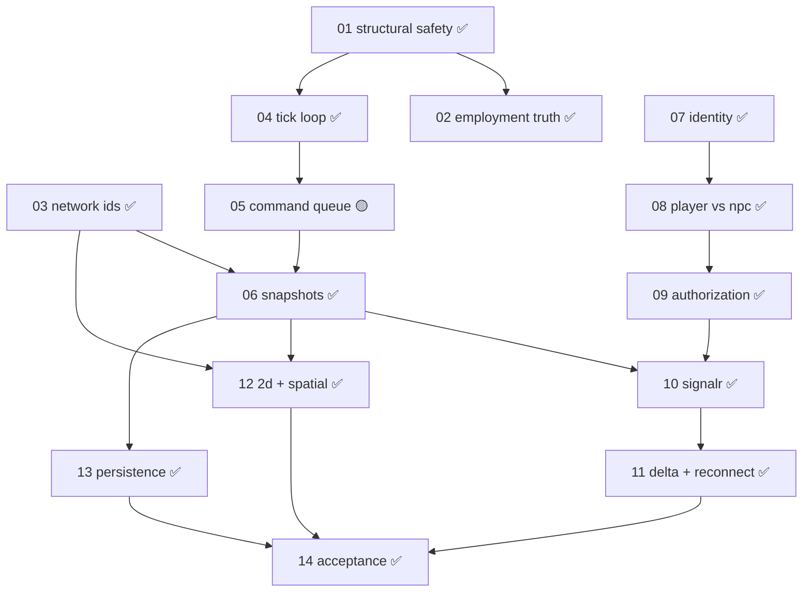

# Multiplayer V1 — Step Index

**Status:** Steps 01–04 and 06–14 done; step 05 is partial (command intents not drained).

One world, server-authoritative, up to 32 concurrent players. No instances or lobbies.

## Order and dependencies

Legend: ✅ done · 🟡 partial

## Rules

- One step = one PR-sized change; do not merge without its acceptance criteria and tests.
- Steps 01–02 are prerequisites; they fix shared-world corruption.
- Steps 03–06 build the internal server loop before any client is connected.
- Transport (10–11) is added only after the server can produce snapshots.
- Persistence (13) is required before calling V1 done.
