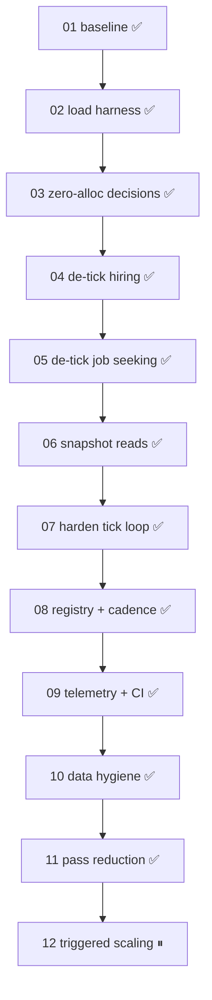

# Performance & Scaling — Step Index

**Status:** Steps 01–11 done; step 12 is trigger-gated and not activated.

Keep one authoritative world responsive as NPC count and system count grow.

## Order

Legend: ✅ done · ⏸ trigger-gated (not activated)

## Rules

- No optimization without a Phase-0 baseline.
- Land steps 03–07 before any spatial/AOI/parallelism work.
- Steps 12 items are trigger-gated; do not start them speculatively.
