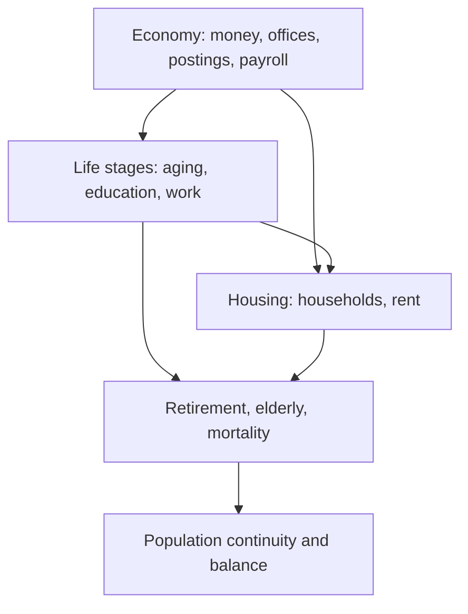

# Roadmap V1 — Realistic Population Simulation

**Scope:** backend + admin web only. No game engine, no 2D client, no rendering, no input.

**Target:** a population of NPCs that earns, spends, rents, ages, retires and dies inside a closed economy that already exists in the repository today (`Office`, `JobPosting`, `HiringSystem`, `PayrollSystem`, `Wallet`).

---

## Feature folders

| Folder | Feature | Tech steps |
|---|---|---|
| `01-economy/` | Economy built on offices, job postings, payroll and hiring | 22 |
| `02-housing/` | Housing, households, rent, homelessness and housing supply | 15 |
| `03-life-stages/` | Education → Work → Retirement → Elderly, plus death and estate | 22 |

Feature-level detail was removed after V1 shipped; recover it from git history if needed. See [STATUS.md](STATUS.md) for the delivered state.

---

## What already exists

| Area | Current implementation |
|---|---|
| Entities | Arch ECS `World`; genoses and companies are entities with components |
| Identity | `NetworkId` + `NetworkIdRegistry` |
| Labour market | `Office`, `JobPosting`, `OpenPosition`, `JobApplication`, `Employee`, `EmploymentIndex` |
| Hiring | `HiringSystem` (`Genelife/Systems/HiringSystem.cs:20`), collect → decide → apply |
| Payroll | `PayrollSystem` (`Genelife/Systems/PayrollSystem.cs:11`), 300-tick cadence, pays from nothing |
| Money | `Wallet` float balance only; companies have no money |
| Needs | `Needs`, `NeedsDecaySystem`, `DecisionSystem`, `ActionSystem` |
| Read model | `WorldDataStatus` snapshot + `/api/data` (`Genelife.API/Endpoints/WorldDataEndpoints.cs:10`) |
| Admin UI | Blazor WebAssembly `Genelife.Web`, `Data.razor` tabs, `/api/data` polling |
| Tick loop | 20 Hz fixed step (`SimulationLoop`), systems registered in `SimulationEngine.Initialize` (`Genelife.API/Services/SimulationEngine.cs:91`) |
| Persistence | Snapshot file + Marten `GenosDocument` / `CompanyDocument`; event writer off the tick thread |

Not present today: company accounts, offices creation API, job posting API, age progression, life stages, schools, housing, rent, pensions, health, mortality, households, population generation, economy/housing admin pages.

---

## Shared design decisions

These are referenced by all three features. Change them only by editing this section first.

### Time

Payroll already runs every 300 ticks. That cycle becomes **one in-game quarter**.

| Unit | Ticks | Real time at 20 Hz |
|---|---|---|
| Month | 100 | 5 s |
| Pay cycle / quarter | 300 | 15 s |
| Year | 1,200 | 60 s |

`SimulationClockOptions.TicksPerYear = 1200` is configurable. A full 0–80 life takes ~80 real minutes at default speed. `Alive.Age` stays the public age in years; `AgeTicks` is the authoritative accumulator.

### Money

Gameplay money moves to integer cents to make payroll, rent and ledgers reconcile exactly.

```csharp
public readonly record struct Money(long Cents)
{
    public decimal Units => Cents / 100m;
    public static Money FromUnits(decimal units) => new((long)Math.Round(units * 100m, MidpointRounding.AwayFromZero));
    public static Money operator +(Money a, Money b) => new(a.Cents + b.Cents);
    public static Money operator -(Money a, Money b) => new(a.Cents - b.Cents);
}
```

DTOs expose `decimal`; ECS components store `Money`. `Wallet` migrates in `01-economy/tech/01`.

### Command path

New admin mutations do **not** touch the `World` from the HTTP thread. They enqueue typed commands that `SimulationEngine.Tick` drains before systems run. HTTP returns `202 Accepted` with a command id; the UI polls the read model. This preserves the single-writer tick loop already established.

### Derived indices

Hot reads use plain-C# indices shared between writers and readers, following `EmploymentIndex`:

- `EmploymentIndex` — employment (exists)
- `HousingRegistry` — properties, occupancy, arrears
- `LifecycleIndex` — stage counts, school enrollment, pension membership

Indices are rebuilt on restore and updated only in apply phases.

### System ordering

`SystemRegistry` rejects duplicate order numbers. The roadmap reserves these gaps:

| Order | System | Cadence | Feature |
|---|---|---|---|
| 80 | `HousingModifierSystem` | 100 | housing |
| 90 | `AgingSystem` | 20 | life |
| 95 | `HealthSystem` | 100 | life |
| 100 | `NeedsDecaySystem` (modified) | 1 | base |
| 200 | `DecisionSystem` (modified) | 1 | base |
| 300 | `ActionSystem` | 1 | base |
| 310 | `EnrollmentSystem` | 100 | life |
| 320 | `EducationSystem` | 100 | life |
| 330 | `WorkScheduleSystem` | 25 | life |
| 340 | `AttendanceSystem` | 100 | life |
| 350 | `CareerSystem` | 1200 | life |
| 390 | `StageProgressionSystem` | 20 | life |
| 400 | `HiringSystem` (modified) | 25 | economy |
| 450 | `CompanyRevenueSystem` | 300 | economy |
| 460 | `ConsumerSpendingSystem` | 100 | economy |
| 500 | `PayrollSystem` (rewritten) | 300 | economy |
| 505 | `PensionSystem` | 100 | life |
| 510 | `RentSystem` | 100 | housing |
| 512 | `HousingMoveSystem` | 100 | housing |
| 514 | `HousingMarketSystem` | 100 | housing |
| 515 | `MaintenanceSystem` | 100 | housing |
| 525 | `UnemploymentBenefitSystem` | 300 | life |
| 530 | `BankingSystem` | 300 | economy |
| 535 | `CorporateTaxSystem` | 300 | economy |
| 538 | `CreditSystem` | 300 | economy |
| 540 | `CompanySolvencySystem` | 300 | economy |
| 560 | `ElderDeclineSystem` | 100 | life |
| 570 | `MortalitySystem` | 600 | life |
| 575 | `NeedsDeathSystem` | 1 | life |
| 576 | `DeathProcessingSystem` | 1 | life |
| 580 | `EstateSettlementSystem` | 100 | life |
| 590 | `PopulationInflowSystem` | 100 | life |
| 595 | `HousingDevelopmentSystem` | 300 | housing |
| 600 | `JobSeekerSystem` (modified) | 100 | economy |
| 610 | `EconomyMetricsSystem` | 1200 | economy |
| 611 | `HousingMetricsSystem` | 1200 | housing |
| 620 | `PopulationMetricsSystem` | 1200 | life |

All new systems follow the existing collect → decide → apply rule: no `world.Create/Add/Remove/Destroy` inside a query callback.

### Determinism

`Random.Shared` is banned in systems. Each system gets a `SimulationRandom` stream derived from a world seed so population generation, skill gain, mortality and market events replay identically.

---

## Delivery order



1. **Economy foundation** — money type, company accounts, office/posting APIs, company-funded payroll. This removes the current "wages from thin air" behaviour and is a prerequisite for housing and life stages.
2. **Life stages** — aging clock, stage transitions, education and work integration. Work depends on a functioning labour market.
3. **Housing** — households, rent and quality effects. Housing consumes wages and needs a stable economy.
4. **End game** — retirement, pensions, elderly decline, mortality, estates, immigration, population metrics.
5. **Admin surface** — each feature ships its own read models, endpoints and Blazor pages in the same PR as the systems.

Features are ordered, not strictly serial: economy steps 01–10 unblock life-stage education and work; housing can start after economy payroll and company accounts land.

---

## Admin web deliverables

The admin UI stays a read-mostly operations console:

| Page | Feature | Main actions |
|---|---|---|
| Economy | 01 | create office, open/close posting, hire/fire, capitalise company, freeze hiring, inspect ledger and arrears |
| Housing | 02 | create property, set rent, assign/evict tenant, inspect rent roll and vacancy |
| Life stages | 03 | create school, enroll student, force stage transition, inspect pension fund and mortality log, spawn population |

All pages follow `Data.razor`: polling read model, summary cards, tabs, `EmptyState`, explicit error banner, admin auth via `GameDataService`. No direct world access from the browser.

---

## Repository conventions

- Backend code: `Genelife/Components`, `Genelife/Systems`, `Genelife.Messages`, `Genelife.API`.
- Tests: `Genelife.UnitTests/{Systems,Repositories,Integration,Performance}` using xUnit and `World.Create()`.
- Money in `Money.Cents`; never compare floats for balances.
- New endpoint style: Wolverine HTTP attributes in `Genelife.API/Endpoints/Wolverine`, admin policy required for mutations.
- New events go through `SimulationEngine.OutboundEvents`; never write to Marten on the tick thread.
- Every tech step ends with build + `dotnet test` green and its own acceptance checks.

---

## Definition of done for V1

- Companies earn revenue, pay wages they can afford, and can go bankrupt.
- Every working-age NPC has a stage-appropriate role: student, worker, retiree or elder.
- NPCs live in a property, pay rent, and can lose it.
- Ages advance; NPCs graduate, work, retire, decline and die.
- Death settles debts and transfers or escheats the estate.
- Population remains stable over a 10-year simulated run via immigration and labour demand.
- All three features are observable and operable from the admin web interface.
- New systems meet the existing tick budget guardrails at 2,000 NPCs.
