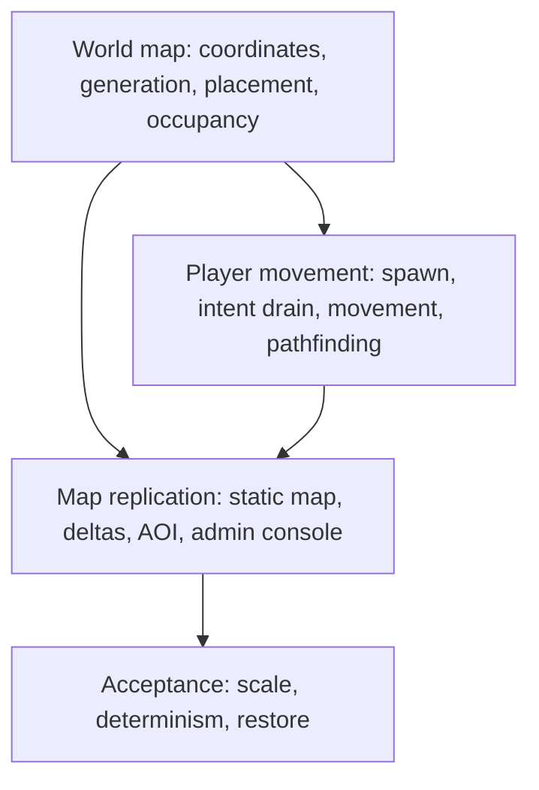

# Roadmap V2 — Spatial World, Buildings and Player Presence

**Scope:** backend + admin map console only. No game engine, no 3D client, no rendering pipeline, no gameplay input beyond the existing admin/multiplayer surfaces.

**Target:** every building has one validated footprint on a deterministic tile map; every human-controlled sim has a server-authoritative position, movement target and replication contract; clients receive a static map layout plus dynamic sim positions without turning the tick snapshot into a map dump.

> Implementation status: V2 is implemented. See [STATUS.md](STATUS.md) for evidence and deferred follow-ups.

**Builds on:** V1 economy, housing, life stages, snapshots, SignalR replication and the existing `Location`, `SpatialIndex`, `AoiFilter`, `PlayerControlled`, `MoveIntent` and command queues.

---

## Feature folders

| Folder | Feature | Tech steps |
|---|---|---|
| `01-world-map/` | Shared tile map, deterministic generation, building placement and occupancy | 11 |
| `02-player-movement/` | Player-controlled sims, intent drain, movement, collision and pathfinding | 11 |
| `03-map-replication/` | Static map snapshot, map deltas, AOI, admin map console and observability | 10 |

Feature-level detail was removed after V2 shipped; recover it from git history if needed. See [STATUS.md](STATUS.md) for the delivered state.

---

## What exists today

| Area | Current implementation |
|---|---|
| World | Arch ECS `World`; sims, companies, properties, units, households, offices and schools are entities |
| Tick loop | Fixed-step `SimulationLoop`; systems registered explicitly in `SimulationEngine.Initialize` |
| Positions | `Location` is a `Vector2` on sims (`Genelife/Components/Gen/Location.cs`) |
| Spawning | Sim creation paths write `new Location(0f, 0f)`; every sim starts at the same point |
| Buildings | `Property`, `Office` and `School` carry `District` but no position or footprint |
| Spatial index | `SpatialIndex` exists in `Genelife/Systems/SpatialIndex.cs` but is not wired into the tick loop |
| AOI | `AoiFilter` exists in `Genelife.API/Snapshots/AoiFilter.cs` but is not used by the broadcaster |
| Player identity | `PlayerControlled { PlayerId }`; ownership is checked by `CommandAuthorizationService` |
| Player intents | `MoveIntent` and `ICommandQueue` exist; `WorldHub.SubmitIntent` enqueues, but nothing drains the intent queue |
| Admin commands | Typed `AdminCommand` queue is drained at tick start by `SimulationEngine.DrainAdminCommands` |
| Snapshots | `WorldSnapshot` carries sims and companies; full and delta replication with reconnect support |
| Persistence | `PersistedWorldState` schema version 4; `PersistedSim` has `X/Y`; office, property and school records have no position |
| Admin UI | Blazor WebAssembly pages for data, economy, housing and lifecycle; no map page |

All positions are therefore nominal today. The map work is not a rendering feature; it is a domain and consistency feature.

---

## Shared design decisions

These are referenced by all three features. Change them only by editing this section first.

### Map model

One map per simulated world, identified by `MapId`, `MapVersion` and `MapSeed`.

- Coordinates are integer tiles. Floats are output only, for presentation or sub-tile interpolation.
- Tile coordinates are signed and centred on the world origin to match the existing `SpatialIndex` bounds and the current X/Y snapshot fields. A default map is 256 × 256 tiles (`-128..127`), configurable through `MapOptions`.
- One tile equals one world unit for DTO compatibility. `Location` remains the float world-space view; `TilePosition` is the authoritative tile.
- The map is generated once from a seed. Regenerating with the same seed and version must produce the same terrain, roads, lots and building placements.

### Authoritative state

- A building owns exactly one `Placement` (anchor, footprint, entry, kind). Residential units and employees inherit the building position; they never duplicate coordinates.
- A sim owns exactly one `TilePosition` and one derived `Location`. The tile position is authoritative; the float location is updated in the same apply phase.
- `PlayerControlled` owns identity, not position. A player is a sim plus a `PlayerId`, not a separate spatial entity.

### Derived indices

Hot reads use derived indices that are rebuilt on restore and updated only in apply phases:

- `WorldMap` — static occupancy, walkability, lots, districts and building lookup (new).
- `MovementIndex` — current routes and path-request state (new; paths are not stored in ECS components).
- `SpatialIndex` — dynamic sim lookup for neighbours and AOI (existing, wired in V2).

The occupancy grid is never persisted as authoritative state.

### Static layout versus dynamic state

- `MapSnapshot` carries the static layout: metadata, roads, zones and building placements.
- `WorldSnapshot` / `WorldSnapshotDelta` carry dynamic sim state, including positions.
- Building changes are rare and travel as `MapDelta`, not inside every tick snapshot.

### Command path

- HTTP admin mutations enqueue typed `AdminCommand`s and return `202`; they never mutate the `World` on the HTTP thread.
- Player intents enqueue `Intent`s through `WorldHub`; the tick loop drains them before systems run.
- Both paths apply under the simulation write lock at tick start.
- Idempotency keys and sequence numbers prevent duplicate movement or placement commands.

### Player movement authority

- Clients send targets, never authoritative positions.
- The server validates ownership, bounds and walkability, computes movement and broadcasts the result.
- Client-side interpolation uses the existing tick + position contract; it never overrides server state.

### System ordering

`SystemRegistry` rejects duplicate order numbers. V2 reserves:

| Order | System | Cadence | Feature |
|---|---|---|---|
| 40 | `MovementSystem` | 1 | player movement |
| 35 | `PathfindingSystem` | 1 | player movement |
| 330 | `WorkScheduleSystem` (modified) | 25 | player movement / NPC commute |
| 612 | `MapMetricsSystem` | 1200 | world map |

Building placement is not a tick system; it runs inside command application before systems. Map reconciliation runs on restore and in tests.

### Determinism

- `Random.Shared` stays banned in simulation code.
- Map generation, lot choice and fallback spawn selection use `SimulationRandom` streams derived from the world seed and a named purpose (for example `map-generation`, `placement`, `spawn`).
- All placement iteration and path tie-breaking use stable ordering.
- Movement uses tick delta time, never wall-clock time.

### Persistence

- `PersistedWorldState.CurrentSchemaVersion` moves from 4 to 5.
- `PersistedMap` stores `MapId`, `MapVersion`, seed, bounds and tile size.
- `PersistedPlacement` stores one row per building keyed by network id.
- `PersistedSim` gains `TileX`, `TileY`, `SubTileX`, `SubTileY`, `MoveTargetX` and `MoveTargetY`.
- V4 snapshots migrate to V5 by deterministically backfilling a placement for every existing building.

---

## Delivery order

1. **World map** — coordinate contract, placement component, occupancy index, deterministic generation, one placement service, persistence and map read model. Nothing else can be reliable until every building has a validated position.
2. **Player movement** — bind players to sims, drain intents, add movement and pathfinding, spawn at home or a valid fallback, integrate NPC commute with building entries.
3. **Map replication** — separate static layout from dynamic position deltas, wire AOI behind the existing scaling trigger, ship the admin map console.
4. **Acceptance** — scale, determinism, restore and multiplayer scenarios.

Features are ordered, not strictly serial: the player movement wire contract can start after M05 (placement service) and M06 (bootstrap), while replication starts after M09 (read model).

---

## Admin web deliverables

The admin UI stays a read-mostly operations console:

| Page | Feature | Main actions |
|---|---|---|
| Map | 01, 03 | inspect generated map, building footprints, entries, occupancy and player positions; place or validate a building; filter by kind and district |
| Data | 02 | show tile position, movement target and current building for each sim |
| Economy | 01, 02 | show office location and entry; link an office to the map |
| Housing | 01, 02 | show property location and unit inheritance; link a property to the map |
| Lifecycle | 01, 02 | show school location and commute target |

All pages follow the existing polling read model, `EmptyState` and command-result pattern. No direct world access from the browser.

---

## Repository conventions

- Backend domain: `Genelife/Map`, `Genelife/Components/Map`, `Genelife/Components/Gen`, `Genelife/Systems`.
- Contracts and events: `Genelife.Messages`.
- API, persistence, snapshots and hubs: `Genelife.API`.
- Tests: `Genelife.UnitTests/{Map,Systems,Snapshots,Persistence,Integration,Performance}` using xUnit and `World.Create()`.
- New endpoint style: Wolverine HTTP attributes in `Genelife.API/Endpoints/Wolverine`; admin policy required for mutations.
- Never persist `Entity` values; persist `NetworkId`.
- Never create, add, remove or destroy entities inside a query callback. Use collect → decide → apply.
- Every tech step ends with `dotnet build GeneLife.sln` and the unit-test run described in the root README.

---

## Definition of done for V2

- Every property, office and school has one placement with a positive footprint and an in-bounds, walkable entry.
- No two building footprints overlap; the occupancy grid rebuilt on restore matches component placements exactly.
- A seeded map regenerates identically, including terrain, roads, lots and initial building positions.
- Every sim spawns in bounds on a walkable tile; every player-controlled sim spawns at a residence entry or a deterministic fallback.
- Player intents are drained each tick, authorised, validated and executed server-side.
- Movement respects bounds, building footprints and map obstacles; pathfinding is budgeted and deterministic.
- Save/restore preserves exact tile positions, movement targets and building placements; the movement path cache is rebuilt, not persisted.
- Clients receive a full map on connect, map deltas on building changes and filtered position updates through AOI.
- The admin map console exposes the generated map, building footprints, entries and live player positions.
- The V2 systems meet the existing tick budgets at 2,000 NPCs and remain stable with 32 connected players.
