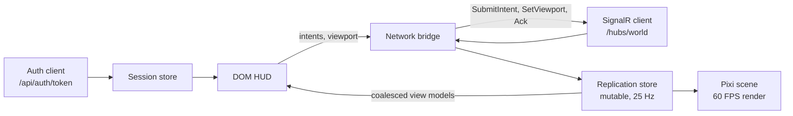
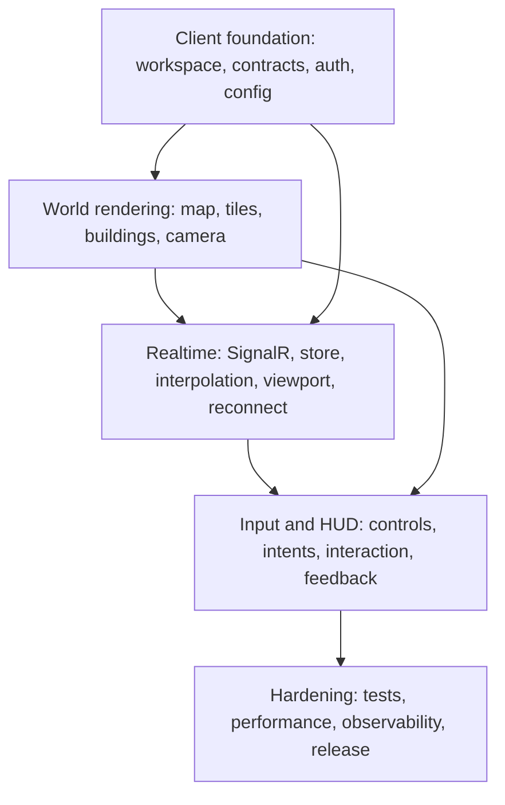

# Roadmap V3 — Browser Game Client

**Scope:** a browser-only 2D game client built on the V2 server and replication contracts. No Godot, no native desktop shell, no engine rewrite, no client-authoritative simulation.

**Target:** a playable browser client that renders the deterministic map, shows nearby sims and buildings, moves the player through server-authoritative intents, survives reconnects, and gives enough HUD feedback to run a vertical slice with real players.

**Builds on:** V1 economy, housing and life stages; V2 map, placement, movement and replication; the `Genelife.Contracts` assembly; `WorldHub`; `/api/auth/token`; `MapSnapshot`; `SendSnapshot`/`SendSnapshotDelta`; viewport subscriptions and reconnect acknowledgements.

> Implementation status: V3 is implemented in `clients/browser`. See [STATUS.md](STATUS.md) for verification and known gaps.

---

## Feature folders

| Folder | Feature | Tech steps |
|---|---|---|
| `01-client-foundation/` | Workspace, contracts, auth, config and asset bootstrap | 5 |
| `02-world-rendering/` | PixiJS scene, RLE map decoding, tiles, buildings and camera | 5 |
| `03-realtime-presence/` | SignalR, replication store, interpolation, viewport and reconnect | 6 |
| `04-input-and-hud/` | Input, intents, building interaction and DOM HUD | 6 |
| `05-hardening-and-release/` | Tests, performance, observability, deployment and release | 6 |

Feature-level detail was removed after V3 shipped; recover it from git history if needed. See [STATUS.md](STATUS.md) for the delivered state.

---

## What exists today

| Area | Current implementation |
|---|---|
| Server | .NET 10 `Genelife.API`; fixed-step simulation; server-authoritative movement and interactions |
| Contracts | `Genelife.Contracts` (`net10.0`) with map, snapshot, viewport and intent DTOs |
| Auth | `POST /api/auth/token` issues a player JWT; hub accepts `access_token` on `/hubs/world` |
| Transport | SignalR JSON hub at `/hubs/world`; REST for auth and read models |
| Map | `SendMapSnapshot` on connect; `MapSnapshot` with per-row RLE tiles and a separate building list |
| Dynamic state | `SendSnapshot` and `SendSnapshotDelta`; `WorldSnapshotDelta` carries sims, companies and removals |
| Viewport | `SetViewport(SetViewportRequest)` returns `ViewportResult`; default viewport derives from the player tile |
| Reconnect | `RequestSnapshot(long? sinceTick)`, `AcknowledgeSnapshot(long tick)`, force-full after viewport changes |
| Map refresh | `RequestMapSnapshot`, map deltas and `/api/map/snapshot` (player policy, rate-limited) |
| Admin | Blazor WebAssembly `Genelife.Web` for data, economy, housing, lifecycle and map inspection |
| Client | `clients/browser`: TypeScript, Vite, PixiJS, SignalR, DOM HUD. |

The two client-blocking contract additions in the original plan are now implemented:

- `Welcome` is sent on connect with the player's own sim `NetworkId`, tick interval, protocol version and map version.
- `IntentRejected` is delivered with sequence + code when movement or interaction validation fails after `SubmitIntent` has returned success.
- A new browser player gets a controllable sim on connect, and browser CORS allows credentials for SignalR negotiate.

The roadmap focus remains client integration, rendering, input, UX and release work, not new simulation features. See [STATUS.md](STATUS.md).

---

## Non-goals

- No Godot or native desktop client in V3.
- No React requirement. React is optional for the HUD after the vertical slice and must not own the render loop or entity state.
- No Redux for the simulation or entity stream.
- No client-authoritative positions, movement, collision or interactions.
- No mobile-specific control scheme in the first slice, beyond keyboard and pointer basics.
- No chat, social graph, matchmaking, accounts UI or payments.
- No server gameplay changes unless a client-blocking contract defect is found; those are tracked as prerequisites in [STATUS.md](STATUS.md).

---

## Shared design decisions

These are referenced by all five features. Change them only by editing this section first.

### Client stack

- **TypeScript + Vite** for the application, build and environment handling.
- **PixiJS** for the world: WebGL renderer, sprite batching, tinting, culling and camera transforms.
- **`@microsoft/signalr`** for the hub connection. Do not implement the SignalR protocol by hand.
- **DOM + CSS** for HUD and panels in the first slice.
- **No React in the world.** If React is added later, it wraps the HUD only and subscribes to low-frequency view models.
- **No Redux.** Use a mutable simulation store for entities, a small observable session/UI store, and explicit events. Zustand can replace the UI store later without touching the simulation store.

### State model

There are three separate stores, and they must not be merged:

| Store | Frequency | Owner | Contents |
|---|---|---|---|
| Simulation store | 25 Hz | Network/render layer | sims by `NetworkId`, interpolation buffer, map cache, local player, viewport |
| Session store | low | Auth/connection layer | token, player id, connection state, map id/version, last ack |
| UI store | low | HUD layer | selected entity, panel state, notifications, settings, errors |

Rules:

- The simulation store is mutable and lives outside any UI framework.
- PixiJS reads the simulation store directly on the render tick.
- HUD receives coalesced updates at 4–10 Hz; it does not rerender for every delta.
- A full snapshot replaces the simulation store; a delta mutates it in place.
- `RemovedSims` deletes entities. Never keep orphan sprites.

### Transport contract

| Direction | Name | Purpose |
|---|---|---|
| Server → client | `SendMapSnapshot` | full static map on connect or refresh |
| Server → client | `SendMapDelta` | building changes between map versions |
| Server → client | `SendSnapshot` | full dynamic world, filtered by viewport if active |
| Server → client | `SendSnapshotDelta` | changed/removed sims and companies since an acknowledged tick |
| Server → client | `SnapshotRejected` | rate-limit or request rejection feedback |
| Client → server | `SetViewport(SetViewportRequest)` | camera bounds in tile coordinates; returns `ViewportResult` |
| Client → server | `ClearViewport()` | opt out of filtering |
| Client → server | `AcknowledgeSnapshot(long tick)` | tell the server the last applied tick |
| Client → server | `RequestSnapshot(long? sinceTick)` | reconnect or gap recovery |
| Client → server | `RequestMapSnapshot()` | force a map refresh |
| Client → server | `SubmitIntent(JsonElement)` | player intent; returns `IntentResult` |

The client sends targets and ticks, never authoritative positions or build state.

### Auth and identity

- `POST /api/auth/token` with `{ "playerId": "..." }` returns a JWT and expiry.
- Pass the token to the hub with `access_token=<jwt>` on `/hubs/world`.
- Keep the token in memory for the session. If persistence is required, use `sessionStorage`, not a long-lived `localStorage` value, and document the XSS tradeoff.
- Refresh before expiry and re-authenticate after a 401.
- The browser origin must be listed in `Cors:AllowedOrigins` for REST calls. SignalR is not exempt from CORS in the browser.

### Map contract

- `MapSnapshot` is the static layout: `MapId`, `Version`, `Seed`, `Width`, `Height`, `TileSize`, bounds, `Tiles` and `Buildings`.
- `Tiles` is run-length encoded per row: `(X, Y, Length, Flags)`. Decode once into a tile index; never keep 65,536 objects in the render loop.
- Tile flags are presentation hints (`Land`, `Road`, `Water`, `Occupied`, `Reserved`). Building occupancy is authoritative in `Buildings`, not inferred from flags.
- The map cache key is `MapId` + `Version`. A map delta advances the version. A version gap requests a full map snapshot.
- `TileSize` and bounds come from the server. Do not hardcode 256×256 or 32 px in game logic.

### Dynamic state and interpolation

- The server broadcasts at 40 ms. The render loop runs at display refresh.
- Keep a short buffer of snapshots/deltas keyed by tick.
- Render at `serverTickTime - interpolationDelay` (start with 100–150 ms).
- Interpolate position between the two surrounding ticks; do not extrapolate more than one tick.
- Snap when the error exceeds a configured threshold, on teleport, on spawn, or after a full snapshot.
- Always include and prioritise the local player’s sim.
- Own-player prediction is out of scope for the first slice; interpolation only.

### Viewport and reconnect

- Derive the initial viewport from the player’s tile and a configured radius.
- On camera movement or zoom, compute the visible tile rectangle, convert it to a center/radius, debounce, and call `SetViewport`.
- Treat `ViewportResult` as authoritative: use the returned center/radius.
- After a viewport change, expect a fresh filtered full snapshot; do not assume deltas are continuous across the change.
- On reconnect, send `RequestSnapshot(null)` unless a valid local tick is known. Acknowledge only after applying a snapshot/delta.
- If the map version changed, request a new map snapshot before rendering new dynamic state.

### Input and intents

- Keyboard: WASD/arrows for camera or movement as configured; pointer for click-to-move and selection.
- Send `MoveIntent` with `TargetTileX`, `TargetTileY`, `SimNetworkId`, `PlayerId`, and a monotonic `Sequence`.
- Do not send legacy float `X`/`Y`.
- Rate-limit locally to avoid server rejection; the server remains the final authority.
- Surface `IntentResult` failures and asynchronous rejection codes in the HUD.
- Interactions use `UseBuildingIntent` with the building `NetworkId`; range and role checks stay server-side.

### Rendering rules

- One Pixi application, one world container, layered containers for terrain, roads, buildings, sims, selection and effects.
- Camera transform on a single container; do not reposition every sprite manually.
- Cull by viewport; keep off-screen entity sprites pooled.
- Use a texture atlas and tinting rather than one texture per variant.
- Never create or destroy Pixi objects inside the network callback; enqueue work for the next frame.
- Keep the HUD outside the canvas so text remains crisp and accessible.

### Error and failure policy

- Connection loss: exponential backoff with jitter; preserve the last rendered frame and show a clear status.
- Snapshot gap: request a full snapshot instead of guessing.
- Map version gap: request a full map snapshot.
- Rejected intent: show a short reason and keep the previous state.
- Rate-limit response: slow down the local sender; do not retry in a tight loop.
- No silent failure. Every connection, map, snapshot and intent error has a visible HUD path and a diagnostic log.

### Build, deploy and testing

- Client lives at `clients/browser/` in this repository initially, with its own `package.json` and CI job.
- Configuration through Vite env vars: `VITE_API_BASE_URL`, `VITE_HUB_URL`, optional feature flags.
- Static hosting with immutable asset hashes; the API base URL is environment-specific.
- No secrets in client code. The player token is obtained at runtime.
- Unit tests: Vitest for the RLE decoder, replication store, interpolation and intent sequencing.
- End-to-end: Playwright against a running API with a seeded world.
- Performance: a synthetic 2,000-sim snapshot and a 256×256 map fixture.

---

## Client architecture



Recommended package layout:

```text
clients/browser/
  src/
    app/            bootstrap, routing-free app shell
    auth/           token and player session
    config/         env parsing and constants
    contracts/      generated REST types + hub DTO types
    net/            SignalR lifecycle, intent sender
    simulation/     mutable stores, interpolation, map cache
    render/         Pixi application, layers, sprites, camera
    input/          keyboard, pointer, selection
    ui/             DOM HUD, notifications, settings
    test/           fixtures and helpers
  public/           tilesets, atlases, audio
```

---

## Delivery order



1. **Foundation** — a bootable client that authenticates, connects, loads contracts and assets, and renders an empty scene.
2. **World rendering** — the map is visible, zoomable, cullable and readable before any live sim moves.
3. **Realtime presence** — snapshots and deltas drive smooth sim sprites, viewport filtering and reconnect recovery.
4. **Input and HUD** — the player can move, select, interact and understand why an action failed.
5. **Hardening and release** — repeatable tests, measured payload/frame budgets, a deployable static build and a release checklist.

Features are ordered, not strictly serial: the contract and auth work unblock SignalR immediately, and map rendering can proceed against recorded fixtures before live replication is finished.

---

## Repository conventions

- Client: `clients/browser/`; TypeScript only, no framework requirement.
- Contracts: generate REST types from the API OpenAPI document; hand-maintain hub DTO types from `Genelife.Contracts` and validate them with JSON fixtures.
- Hub: `/hubs/world`; JSON protocol; `access_token` query for browser auth.
- Auth: `POST /api/auth/token`; do not invent a second login system.
- Tests: `clients/browser` unit tests plus Playwright; server fixtures live under `Genelife.UnitTests` or `clients/browser/src/test/fixtures`.
- Every tech step ends with `npm run typecheck`, `npm run lint`, `npm run test` and, where applicable, `npm run build`.
- Server changes required by a client defect are raised as prerequisites in [STATUS.md](STATUS.md), not silently patched in the client.

---

## Definition of done for V3

- A new player can open the browser client, authenticate, connect and see the map and their own sim.
- The map renders from `MapSnapshot` RLE with correct bounds, tile size, roads, buildings and entries.
- Nearby sims move smoothly from `SendSnapshot`/`SendSnapshotDelta` with interpolation and no ghost sprites.
- The camera pans and zooms; viewport updates are debounced, validated and reflected in server filtering.
- WASD/click-to-move submits valid intents and the player moves under server authority.
- Building interaction submits `UseBuildingIntent` and surfaces success or a typed rejection.
- A dropped connection recovers with a full or delta snapshot, preserves the map cache, and never leaves the client in a half-applied state.
- HUD shows connection, map version, tick, FPS, viewport radius, rejected intents and actionable errors.
- The client passes unit, fixture, Playwright and 2,000-sim render-budget checks.
- A static production build deploys to a configured origin and works against the deployed API.
