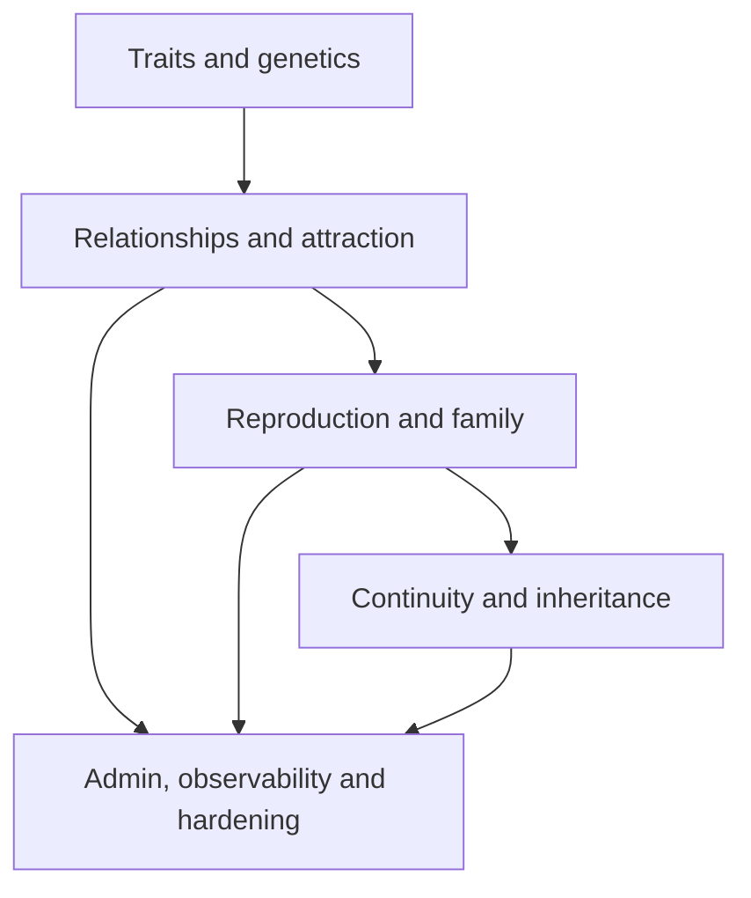

# Roadmap V4 — Relationships, Attraction and Reproduction

**Scope:** server simulation, persistence, read models and admin surfaces. No appearance rendering, no player pregnancy UI, no matchmaking or social graph for players.

**Target:** every genos has a deterministic inherited trait set; eligible genoses form relationships through an explainable attraction score; partners can form households and have children; children inherit traits with mutation, are raised, schooled and eventually enter the workforce; births supplement immigration as a population-continuity path; inheritance follows family relationships; operators can inspect and audit the whole family graph.

**Builds on:** V1 economy/housing/life stages, V2 spatial world and indices, V3 read-model and client conventions, the 2026-11 balance pass, `SimulationRandom`, `EstateSettlementSystem`, `PopulationInflowSystem`, `HousingRegistry`, `HouseholdRole.Child`, `Tenure.Dependent`, `HousingUnit.Capacity`.

> Implementation status: features 01 (traits), 02 (relationships/attraction), 03 (reproduction/family), 04 (continuity/inheritance) and 05 (admin/observability/hardening) are implemented and hardened; V4 is release-ready. The only open follow-up is enabling `CohabitOnPairing`, which needs economy/consumption recalibration. See [STATUS.md](STATUS.md) for release evidence.

---

## Feature folders

| Folder | Feature | Tech steps |
|---|---|---|
| `01-traits-and-genetics/` | Trait schema, seeded traits, inheritance, aptitude, persistence and calibration harness | 8 |
| `02-relationships-and-attraction/` | Relationship edges/index, eligibility, deterministic attraction, pairing and household merge | 11 |
| `03-reproduction-and-family/` | Pregnancy, birth, newborn creation, childhood, household capacity and child costs | 11 |
| `04-continuity-and-inheritance/` | Births vs immigration, widowhood, guardianship, inheritance and long-run balance | 7 |
| `05-admin-observability-and-hardening/` | Family read model, admin page, events/projections, determinism, scale, persistence and release | 8 |

Feature-level detail was removed after V4 shipped; recover it from git history if needed. See [STATUS.md](STATUS.md) for the delivered state.

---

## What exists today

| Area | Current implementation |
|---|---|
| Population | `PopulationGenerator` creates children, workers, retirees and elders; `PopulationInflowSystem` is the only long-run replacement path |
| Life stages | `Lifecycle` (`Education`, `Work`, `Retirement`, `Elderly`), `LifeStagePolicy`, `StageProgressionSystem`, `SkillProfile`, `Health` |
| Households | `Household`, `HouseholdMember`, `HouseholdRole` (`Head`, `Partner`, `Child`, `Relative`, `Other`), `Tenure.Dependent`, `Residence`, `HousingRegistry` |
| Housing | `Property`, `HousingUnit` with `Capacity` and `OccupantCount`, `IsOvercrowded`, allocation, rent, eviction, construction, ownership |
| Inheritance | `DeathProcessingSystem` computes heirs from current household members; `EstateSettlementSystem` pays debts, funeral, heirs and escheat |
| Traits | None. Genoses have age, name, `SkillProfile`, health and needs only |
| Relationships | None. No parent, partner or guardian edge exists |
| Reproduction | None. No pregnancy, birth path or newborn creation path |
| Attraction | Orphaned `AttractivenessService` ML.NET prototype outside `GeneLife.sln`; not a runtime dependency |
| Randomness | `SimulationRandom.For(streamName)`; `Random.Shared` is banned in simulation code |
| Persistence | `PersistedWorldState` schema 5 (V4 advances to schema 11 with family, state-care, ended-edge and `HasWallet` persistence), persisted economy/housing options and `BalanceBackfilled` one-time migration |
| Admin | Data, Economy, Housing, Lifecycle and Map pages; lifecycle and population read models |
| Tests | Unit, persistence, snapshot, integration and the `BalanceScenarioTests` decade report |

Initial family structure is weak: the generator creates one household per adult and assigns children to random adult households. V4 replaces that with explicit partnerships and parent edges for seeded populations, with a deterministic backfill for legacy saves.

---

## Non-goals

- No rendered appearance, portraits or genetic visual traits in the client.
- No player-controlled pregnancy, childbirth or childcare UI.
- No player matchmaking, chat, social feed or dating loop.
- No divorce litigation, custody disputes or adoption market in V4a.
- No complex genetic disease model, polygenic traits or hidden multi-allele simulation in V4a.
- No `Microsoft.ML` or model inference inside the tick loop.
- No family-tree visualisation beyond the admin read model.
- No client-side authority over relationships, pregnancy or birth.
- No changes to the V1 money loop that mint money; every family transfer is ledgered.

---

## Shared design decisions

These are referenced by all five features. Change them only by editing this section first.

### Time and cadence

Reuse the existing clock: 1,200 ticks per year, 100 ticks per month, 300 ticks per payroll quarter.

| Concern | Cadence |
|---|---|
| Relationship exposure | monthly |
| Attraction score refresh | quarterly |
| Pairing decision | quarterly |
| Conception check | monthly |
| Pregnancy progression | monthly |
| Birth resolution | monthly |
| Family/household reconciliation | monthly |
| Family metrics | yearly |
| Population and balance metrics | yearly |

All new systems are registered by explicit order and must respect the collect → decide → apply rule. No entity creation, add, remove or destroy inside a query callback.

### Trait model

The trait model is the schema shared by genetics, attraction and reproduction. It mirrors the `AttractivenessService` feature set so the model remains usable as an offline calibration oracle, while fitting the ECS.

```csharp
namespace Genelife.Components.Gen;

public enum EyeColor : byte { Brown, Blue, Green, Grey, Hazel }
public enum HairColor : byte { Black, Brown, Blonde, Ginger, Grey }
public enum Handedness : byte { Right, Left, Ambidextrous }
public enum Morphotype : byte { Ectomorph, Mesomorph, Endomorph }
public enum Aptitude : byte { Science, Art, Craft, Social, Physical }
public enum HeightPotential : byte { Short, Average, Tall }
public enum Sex : byte { Female, Male }
public enum Temperament : byte { Peaceful, Neutral, Violent }

public record struct Traits
{
    public EyeColor EyeColor;
    public HairColor HairColor;
    public Handedness Handedness;
    public Morphotype Morphotype;
    public Aptitude Aptitude;
    public HeightPotential HeightPotential;
    public Sex Sex;
    public Temperament Temperament;
}
```

| Decision | Rule |
|---|---|
| Storage | `byte`-backed enums in one `Traits` record struct. No strings in hot state or snapshots. |
| Age | Never duplicated. Derived from `Alive.Age` / `Lifecycle.AgeTicks`. |
| Intelligence | `Aptitude` is a heritable aptitude that biases starting `SkillProfile` and learning, not a second skill score. |
| Hair naming | The prototype's `HairType` values are colours; canonical name is `HairColor`, with a mapping adapter for calibration. |
| Sex | Used only for reproduction eligibility and pairing policy. No other system may read it for social role or pay. |
| Inheritance (V4a) | Each trait takes one parent's value plus a bounded mutation. No hidden alleles in V4a. |
| Genetic vs acquired | Genetics owns potential/aptitude and temperament baseline. Runtime systems own realised skills, health, income and housing. |
| Attraction evaluator | Deterministic integer basis-point score in C#. Coefficients are calibrated offline; no ML runtime dependency. |
| Fairness | Traits are simulation inputs, not player value judgments. Admin pages show them for debugging only; no public ranking. |
| Persistence | Traits are persisted per genos; schema 5 → 6 with deterministic backfill from world seed + `NetworkId`. |

### Relationship model

Relationships are directed edges stored on edge entities, not fixed slots on a genos:

```csharp
public enum RelationshipKind : byte
{
    Parent, Child, Partner, ExPartner, Guardian, Ward
}

public record struct Relationship
{
    public Entity From;
    public Entity To;
    public RelationshipKind Kind;
    public long SinceTick;
    public RelationshipSource Source;
}
```

Rules:

- Each edge is one direction. `Parent`/`Child`, `Guardian`/`Ward` and `Partner` are maintained as mirror pairs by the relationship service.
- `ExPartner` is a historical fact; it does not remove the shared children or their edges.
- Siblings, grandparents and in-laws are derived from parent and partner edges; they are not stored.
- The relationship index is derived, rebuilt on restore and updated only in apply phases, following `EmploymentIndex` and `HousingRegistry`.
- No self-edges, no duplicate same-kind edges, no ancestry cycles.
- A genos may have at most one current `Partner` in V4a.

### Attraction and pairing

Attraction is explainable, deterministic and bounded:

- Score in integer basis points from `0` to `10,000`.
- Components: trait compatibility, age preference, proximity or shared institution, socioeconomic stability, health, and existing relationship status.
- Candidate generation uses household, workplace, school and `SpatialIndex` neighbours; it never scans the whole population per genos.
- Attractiveness vectors are precomputed per eligible genos per quarter.
- Only opposite-sex pairs are eligible in V4a; same-sex pairing is deferred until the policy is revisited.
- Pairing keeps partners in separate households by default (`CohabitOnPairing = false`) until births add household formation; capacity-aware merge is implemented and opt-in.
- Pairing requires mutual eligibility, a score above the configured threshold, and mutual acceptance drawn from `SimulationRandom`.
- Pairing creates mirrored `Partner` edges and attempts a household merge; a partnership may exist across households when capacity is unavailable.

### Reproduction and family

- `Pregnancy` is a separate entity with a `NetworkId`, a carrying parent, an other parent, conception tick, due tick, risk and status.
- Conception requires an eligible current partnership, both parents alive and not dependent, a configured fertility window, no existing pregnancy, and a deterministic chance roll.
- V4a defaults to one child per pregnancy. Twins are a future option.
- Birth creates a newborn with `Lifecycle` age 0 in `Education`, `Tenure.Dependent`, `HouseholdRole.Child`, zero wallet, inherited traits and parent edges.
- Newborns are not enrolled until `SchoolStartAge`; enrollment already guards on age.
- A birth never mints money. Child costs are transfers through existing household, school, health and government flows.
- A household may exceed unit capacity temporarily; overcrowding is visible and drives housing demand, not a blocked birth.

### Household and housing

- `HousingUnit.Capacity` and `OccupantCount` are authoritative for crowding.
- `HousingRegistry.AddMember`/`RemoveMember`/`MoveIn`/`MoveOut` remain the only membership path.
- Partnership merge moves the lower-priority genos into the higher-priority home when capacity allows; otherwise it records the partnership and leaves the household split.
- Household head is deterministic: existing head, then oldest adult, then lowest `NetworkId`.
- `Tenure.Dependent` covers children and other dependants; rent remains the household's responsibility.
- Splitting a household on separation or death creates a new household only when a member cannot remain.

### Continuity and inheritance

- Births supplement immigration. `PopulationInflowSystem` keeps its target as a floor and reduces immigration when natural growth closes the gap.
- `PopulationSnapshot` gains births, birth rate, children, average household size, orphan count and dependency ratio.
- Inheritance uses relationship edges: partner and children first, then parents and siblings, then escheat to government.
- A minor's share is held by the guardian until adulthood; the transfer is recorded and released on the minor's 18th birthday.
- Owned housing transfers to the surviving partner or guardian, consistent with the current `TransferHousing` path.
- All inheritance and child-cost money movements go through the ledger. The balance scenario must remain green.

### Determinism

- `Random.Shared` stays banned in simulation code.
- Every draw uses `SimulationRandom` with a named stream: `traits.seed`, `traits.inheritance`, `relationships.exposure`, `attraction.pairing`, `reproduction.conception`, `reproduction.birth`, `names.child`.
- Pair-keyed rolls derive from stable parent network ids and the tick, not from query order.
- All candidate and edge iteration uses stable ordering (network id, then entity id).
- A 10-year run must replay identically from the same seed and options.

### Persistence

`PersistedWorldState.CurrentSchemaVersion` moves from 5 to 6.

- `PersistedGenos` gains trait fields and a `TraitsMigrated` flag.
- New lists: `PersistedRelationship`, `PersistedPregnancy`, `PersistedGuardianship` (if separate from relationship edges), and a `PersistedFamilyOptions`/`RelationshipOptions`/`ReproductionOptions` block.
- Relationship/pregnancy indices are rebuilt on restore, never persisted as authoritative duplicates.
- V5 → V6 backfills traits deterministically and marks legacy family data as `Source=Restored`; no parent edges are invented for old saves.
- The existing `BalanceBackfilled` and persisted options behaviour must be preserved.

### System ordering

`SystemRegistry` rejects duplicate order numbers. V4 reserves:

| Order | System | Cadence | Feature |
|---|---|---|---|
| 355 | `RelationshipExposureSystem` | 100 | 02 |
| 360 | `AttractionSystem` | 300 | 02 |
| 365 | `PairingSystem` | 300 | 02 |
| 370 | `ConceptionSystem` | 100 | 03 |
| 375 | `PregnancySystem` | 100 | 03 |
| 380 | `BirthSystem` | 100 | 03 |
| 385 | `FamilyHouseholdSystem` | 100 | 03 |
| 621 | `FamilyMetricsSystem` | 1200 | 05 |
| 622 | `ReproductionMetricsSystem` | 1200 | 05 |

`TraitSystem` is not a tick system; traits are created with the genos or restored. Existing orders (`390` stage progression, `580` estate settlement, `590` population inflow, `620` population metrics) are unchanged except for explicit integration points.

### Command, event and read-model path

- HTTP admin mutations enqueue typed `AdminCommand`s and return `202`.
- The tick loop drains commands at tick start and applies them under the write lock.
- New events are immutable records in `Genelife.Messages/Events` and are written asynchronously by `SimulationEventWriter`.
- Projections are idempotent and rebuildable.
- The browser never accesses the world directly; it reads polling DTOs and command results.

### Performance

- Candidate generation is capped per genos and uses indices, never a full population cross-product.
- Attractiveness vectors are cached per quarter and invalidated on trait/relationship changes.
- The family read model paginates and filters on the server.
- V4 acceptance runs the 10-year balance scenario plus a 2,000-genos family scenario inside the existing tick budgets.

---

## Delivery order



1. **Traits and genetics** — the schema every later feature reads and writes. Nothing about attraction or inheritance can be tested without it.
2. **Relationships and attraction** — parent/partner/guardian edges, eligibility, deterministic scoring and pairing.
3. **Reproduction and family** — pregnancy, birth, childhood, household capacity and child costs.
4. **Continuity and inheritance** — births vs immigration, widowhood, guardianship, inheritance and long-run population balance.
5. **Admin, observability and hardening** — read model, page, events, projections, determinism, scale, persistence and release.

Features are ordered, not strictly serial: the persistence model and trait generation can start immediately; the family read-model DTOs can be designed against fixtures before the reproduction systems are complete.

---

## Admin web deliverables

| Page | Feature | Main actions |
|---|---|---|
| Family | 02, 03, 05 | inspect traits, relationships, partnerships, pregnancies, guardianships and household composition; filter by household, age, stage and relationship state |
| Lifecycle | 04, 05 | show births, birth rate, replacement rate, children, orphans, average household size and dependency ratio |
| Housing | 03, 05 | show household size, unit capacity, overcrowding and dependants |
| Data | 01, 05 | show trait summary and family identifiers for a genos |
| Economy | 03, 04, 05 | show child costs, school costs, inheritance transfers and family-related government spending |

All pages use the existing polling read model, `EmptyState`, command result pattern and admin authorization. No direct world access from the browser.

---

## Repository conventions

- Domain components: `Genelife.Domain/Components/Gen`, `Genelife.Domain/Components/Life`, `Genelife.Domain/Components/Housing`, new `Genelife.Domain/Components/Family`.
- Domain rules and policies: `Genelife/Family` (traits, genetics, attraction, eligibility, reproduction, inheritance).
- Systems: `Genelife.Application/Systems`.
- Events and commands: `Genelife.Messages`.
- API, DTOs, projections, persistence and admin endpoints: `Genelife.API`; contracts and polling DTOs: `Genelife.Contracts`.
- Tests: `Genelife.UnitTests/{Family,Systems,Persistence,Snapshots,Integration,Performance}` using xUnit and `World.Create()`.
- Never persist `Entity` values; persist `NetworkId`.
- Never create, add, remove or destroy entities inside a query callback.
- Every tech step ends with `dotnet build GeneLife.sln` and the relevant unit-test run.

---

## Open questions

1. **Same-sex pairing and reproduction.** Same-sex pairing is disabled in V4a; only opposite-sex pairs are eligible for partnership and conception. Adoption and surrogacy are deferred. Revisit the policy before widening eligibility.
2. **Divorce/separation.** V4a records `ExPartner` and splits households only for admin-driven or death-driven transitions. Full separation law is deferred.
3. **Orphan care.** Guardian-first, then relatives, then state shelter. Confirm whether a dedicated orphanage entity is required or the existing shelter system is enough.
4. **Child benefits.** Decide whether the government pays a child benefit or only existing school/health costs scale with children.
5. **Inheritance shares.** Default split between partner and children, and whether minors' shares are held in trust or simply reserved.
6. **Trait mutation rate.** Calibrate against population diversity; too high erases families, too low makes traits static.

---

## Definition of done for V4

- Every seeded genos and every newborn has a deterministic `Traits` component; legacy snapshots migrate with a stable backfill.
- Parent, child, partner and guardian edges are persisted, indexed and visible in the read model; no ancestry cycles or duplicate edges.
- Eligible genoses form partnerships through an explainable deterministic score; the same seed and options replay identically.
- Partners merge or split households without breaking rent, capacity, tenure, estates or the money ledger.
- Births create complete, consistent newborns with inherited traits, parent edges, household membership and a dependency record.
- Children are raised, enrolled at school age and transition into work; child costs are funded by real transfers.
- Births become a real continuity path and are reflected in population metrics, immigration policy and the balance scenario.
- Inheritance follows family relationships, supports minors and guardians, and preserves ledger conservation.
- The admin family page exposes traits, relationships, pregnancies, guardianships, household composition and health checks.
- Schema 5 → 6 migration, restore, replay and the 10-year balance scenario pass.
- The 2,000-genos family scenario stays within the existing tick budget.