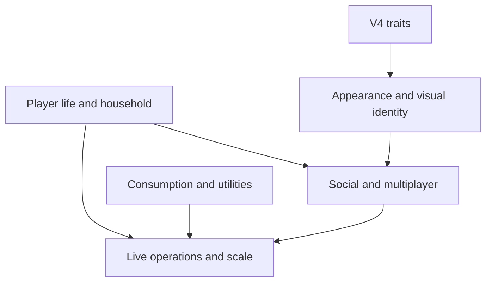

# Roadmap V5 — Playable Society

**Scope:** server simulation, player-facing browser client, persistence, read models and admin surfaces. No Godot or native client, no real-money economy, no client-authoritative simulation.

**Target:** a player can live a full life in the simulated town — hold a job, earn and spend money, keep a home, form a family, be visually distinguishable from NPCs and relatives, interact with other players, and feel water, electricity and grocery constraints — while the economy remains stable at 1k–2k sims and the 32-player world stays server-authoritative.

**Builds on:** V1 economy/housing/life stages, V2 spatial world and indices, V3 browser client and replication, V4 traits/relationships/reproduction/inheritance, the 2026-11 balance pass, `SimulationRandom`, `PlayerControlled`, `Wallet`, `HousingRegistry`, `RelationshipIndex`, `FamilyHouseholdSystem`, `EstateSettlementSystem`, and `PersistedWorldState` schema 11.

> Implementation status: features 01, 02, 04 and 05 are implemented; feature 03 is core-complete with nutrition/trip and cohabitation evidence still in progress. Production V5 sign-off is pending the 30-minute live soak and migration/rollback rehearsal. See [STATUS.md](STATUS.md).

---

## Feature folders

| Folder | Feature | Tech steps |
|---|---|---|
| [`01-player-life-and-household/`](01-player-life-and-household/summary.md) | Player agency, employment, housing, consumption, family actions, aging and heir continuation | 8 |
| [`02-appearance-and-visual-identity/`](02-appearance-and-visual-identity/summary.md) | Trait-driven appearance, portraits, sprites, aging and family resemblance | 7 |
| [`03-consumption-and-utilities/`](03-consumption-and-utilities/summary.md) | Water/electricity networks, outages, grocery stock, nutrition and cohabitation recalibration | 8 |
| [`04-social-and-multiplayer/`](04-social-and-multiplayer/summary.md) | Presence, chat, friendships, consensual player relationships, moderation and shared venues | 8 |
| [`05-live-operations-and-scale/`](05-live-operations-and-scale/summary.md) | Hybrid cleanup, relocation, live preview, audio/touch, prediction decision, balance and release | 8 |

Every feature folder contains:

- `summary.md` — objective, baseline, deliverables, architecture, steps and definition of done.
- `business/` — the feature explained in product-facing terms.
- `tech/` — ordered implementation steps with context, design, tasks, files, contracts and acceptance.

---

## What exists today

| Area | Current implementation |
|---|---|
| Player | Player sims are auto-created on connect. Typed `PlayerActionIntent` commands add job apply/accept/quit, rent/lease/move, shop/consume, partner invitations/consent, child naming and continuation policy. Player sims remain excluded from autonomous decisions, job seeking and work scheduling; presence at their own office counts toward monthly attendance. |
| Economy | Integer-cent `Money`, ledger, company accounts, wages, rent, metered utility billing, grocery revenue, universal basic income, taxes, credit and insolvency. Default utility tariffs are municipality-subsidised to keep the strict balance bands green. |
| Housing | Households, `HousingRegistry`, capacity, rent, arrears, eviction, construction and ownership, plus water/electricity service links, household meters, service levels and outage consequences. |
| Family | Traits, relationship edges, eligibility, attraction, pairing, pregnancy, birth, childhood, guardianship, inheritance and the admin family page. |
| Appearance | `SkinTone` and `FaceShape` extend inheritable traits; `AppearanceDescriptor` derives hair style/color, body frame, height, age band and expression; layered shared-part sprites and an admin SVG preview render it. Browser sims are no longer single tinted circles. |
| Social | One shared world with up to 32 players, bounded nearby/same-venue presence, a privacy-safe player directory, display-name privacy and an admin presence list. No chat, emotes, social graph, reports or moderation tools yet. |
| Consumption | Versioned grocery catalog, per-store inventory, deterministic price/stock pressure, funded restock, spoilage, player purchase/consume path and nutrition state. NPC shopping trips and meal composition remain open. |
| Client | `clients/browser`: TypeScript, Vite, PixiJS, SignalR, DOM HUD, interpolation, viewport, reconnect and an admin Playwright suite. |
| Persistence | `PersistedWorldState.CurrentSchemaVersion` is 14 with traits, appearance, relationships, pregnancies, trusts, state care, player state, utility networks/links/meters, grocery inventory, catalog version and nutrition. |
| Admin | Data, Economy, Housing, Lifecycle, Family, Map, Players, Appearance and Consumption pages. |
| Tests | 577 server tests / 0 failed / 2 skipped and 154 browser tests green; 2,000-sim ten-year run at p95 ~3.1 ms; 30-year continuity run; 60- and 200-sim ten-year balance bands green. |
| Architecture | Hybrid ECS + Wolverine/Marten is the single path: H16 keeps collect→decide→apply, H19 migrated the remaining endpoints, H20 removed the flags, and MP05 is documented as complete. |

V4 ends with a rich NPC society and a player who can walk through it. V5 closes that gap without giving the browser authority over the world.

---

## Non-goals

- No Godot, native desktop shell or engine rewrite. The browser client remains the game client.
- No client-authoritative positions, economy, family state or appearance.
- No real-money economy, payments, loot boxes or purchasable currency.
- No divorce litigation, custody disputes, adoption market or surrogacy market in V5a.
- No polygenic genome, genetic disease model or hidden multi-allele simulation.
- No matchmaking, dating feed, public attractiveness ranking or trait leaderboard.
- No voice/video chat, full social feed or open friend discovery outside the world.
- No unbounded chat history; retention and moderation are part of feature 04.
- No player-owned utility monopolies or player-run grocery chains in V5a; those are economy features after the resource model is stable.
- No full character creator, wardrobe economy or cosmetic marketplace. Appearance is derived from traits and age.
- No silent policy change for same-sex pairing or reproduction. The options exist but default to false; V5 decides the policy explicitly before enabling it.
- No changes to the V1 money loop that mint money. Every player, utility, grocery and family transfer is ledgered.

---

## Shared design decisions

These are referenced by all five features. Change them only by editing this section first.

### Time and cadence

Reuse the existing clock: 1,200 ticks per year, 100 ticks per month, 300 ticks per payroll quarter.

| Concern | Cadence |
|---|---|
| Player action drain | tick start |
| Player employment reconciliation | monthly |
| Player housing reconciliation | monthly |
| Player consumption and needs | daily or existing needs cadence |
| Utility consumption | monthly |
| Utility outage check | monthly |
| Grocery stock and spoilage | daily |
| Nutrition effects | daily |
| Social presence heartbeat | connection lifecycle |
| Chat moderation scan | event-driven |
| Player, appearance, consumption and social metrics | yearly |

All new systems are registered by explicit order and must respect the collect → decide → apply rule. No entity creation, add, remove or destroy inside a query callback.

### Player agency

- `PlayerControlled` sims stay excluded from `DecisionSystem` and `WorkScheduleSystem`. The player is the decision source, not an autonomous NPC.
- Player actions are typed intents, drained at tick start under the write lock, and applied through the same domain services as NPC systems.
- The browser sends targets, choices and ticks, never authoritative balances, positions, relationships or family state.
- Player sims obey the same economy, housing, health, consumption and family rules as NPCs. The only approved creation sources remain initial company capital, initial household cash and universal basic income.
- A disconnected player sim remains in the world and idle. It does not start making autonomous decisions, take a job or form relationships while the player is offline.
- Player-to-player and player-to-NPC family actions require an explicit invitation and acceptance path. There is no silent pairing.
- Player death is a first-class state: the player can continue as an eligible heir, start a new sim in the same world, or observe until the next life. The chosen policy is recorded in feature 01.

### Appearance

- Appearance is derived deterministically from `Traits`, `Alive.Age` and `Sex`. It is not a second source of genetic truth.
- V5 adds `SkinTone` and `FaceShape` to the trait schema as append-only enum values, with a deterministic backfill for legacy sims.
- The client composes sprites and portraits from layered atlas parts plus palette/tint. It never downloads one texture per sim.
- Family resemblance is a consequence of inherited traits, not a separate family portrait rule.
- Aging changes proportions, hair colour and posture within the same trait identity.
- Appearance descriptors are cached and invalidated by trait, age-band or appearance-version changes.
- The admin can preview any sim's appearance; players see appearance only through the world and their own profile.

### Consumption and utilities

- Water and electricity are explicit utility networks with production, capacity, load and outages. They are not a single opaque bill.
- Buildings and households connect to networks through placement and service links. A household without a service is visibly disadvantaged, not silently billed.
- Utility billing and grocery purchases are ledgered transfers. Outages and spoilage destroy service or goods, never money.
- The grocery system has a catalog, store stock, prices, spoilage and nutrition. Consumer spending remains household-level.
- `CohabitOnPairing` flips to true only after feature 03 passes the strict balance bands and the 30-year continuity scenario. The default change is a release decision, not an implementation detail.
- The 1k–2k balance targets remain the acceptance frame: wage share, vacancy, company failures and wealth Gini are reported even when not fully closed.

### Social and multiplayer

- Presence, chat, emotes, friendships and consensual relationships are server-authoritative and event-driven.
- Chat is text only in V5a, with rate limits, retention, mute/block/report and an admin moderation view.
- Friendships and player partnerships are invitations with accept/decline and a persisted edge. No matchmaking or discovery feed.
- Player relationships never grant economic or family authority automatically. A player partnership does not merge wallets or households without the same V4 rules.
- Shared venues are existing world locations (café, park, office, school) with presence and interaction, not a separate lobby system.
- No real names, email addresses or external identifiers are stored in the world. The player id is the identity.
- Moderation actions are audited and reversible where possible.

### Determinism

- `Random.Shared` stays banned in simulation code.
- Every draw uses `SimulationRandom` with a named stream: `player.life`, `appearance.derive`, `appearance.inheritance`, `utilities.outage`, `grocery.stock`, `social.encounter`, `social.moderation`.
- Player input is not random. Replay uses the recorded command/intent log plus the same world seed and options.
- Candidate and iteration order is stable: network id, then entity id.
- A 10-year NPC run with no players must replay identically after V5.
- A 32-player acceptance run must reproduce the same NPC simulation when the same intent log is replayed.

### Persistence

`PersistedWorldState.CurrentSchemaVersion` moves from 11 to 15 across V5.

- Schema 12: player profile, player life state, player household/family bindings and heir policy.
- Schema 13: appearance descriptor version, `SkinTone`, `FaceShape` and deterministic appearance backfill.
- Schema 14: utility networks, service links, household meters, grocery catalog/stock and nutrition state.
- Schema 15: social edges, blocks, reports and player privacy settings.
- Chat history is a Marten document with retention; it is not part of the world snapshot and never blocks restore.
- Appearance descriptors and utility load are derived and rebuilt on restore. Social edges are persisted as facts; presence and derived indices are rebuilt.
- V4 saves migrate deterministically. No player family edges or social edges are invented for legacy saves.
- `BalanceBackfilled`, `TraitsMigrated` and the V4 family migrations must remain intact.

### System ordering

`SystemRegistry` rejects duplicate order numbers. V5 reserves:

| Order | System | Cadence | Feature |
|---|---|---|---|
| 405 | `PlayerLifecycleSystem` | 100 | 01 |
| 410 | `PlayerEmploymentSystem` | 100 | 01 |
| 415 | `PlayerHouseholdSystem` | 100 | 01 |
| 420 | `PlayerConsumptionSystem` | 100 | 01 |
| 470 | `UtilityConsumptionSystem` | 100 | 03 |
| 472 | `UtilityOutageSystem` | 100 | 03 |
| 474 | `GroceryStockSystem` | 100 | 03 |
| 476 | `GrocerySpoilageSystem` | 100 | 03 |
| 478 | `NutritionSystem` | 100 | 03 |
| 630 | `PlayerLifeMetricsSystem` | 1200 | 01 |
| 631 | `AppearanceMetricsSystem` | 1200 | 02 |
| 632 | `ConsumptionMetricsSystem` | 1200 | 03 |
| 633 | `SocialMetricsSystem` | 1200 | 04 |

Player actions themselves are commands drained at tick start, not systems. Existing orders (`390` stage progression, `500` payroll, `510` rent, `580` estate settlement, `590` population inflow, `620` population metrics) are unchanged except for explicit integration points.

### Command, event and read-model path

- HTTP player actions enqueue typed intents and return `202` with a command id.
- HTTP admin mutations enqueue typed `AdminCommand`s and return `202`.
- The tick loop drains commands at tick start and applies them under the write lock.
- New events are immutable records in `Genelife.Messages/Events` and are written asynchronously by `SimulationEventWriter`.
- Projections are idempotent and rebuildable. Chat moderation and social reports use Marten documents with retention.
- The browser never accesses the world directly; it reads polling DTOs, hub messages and command results.
- Player-visible reads are scoped to the player's own sim and public world state. Traits, family details and moderation notes stay admin-only.

### Performance

- Player actions are bounded by a per-player rate limit and a per-tick command budget.
- Appearance composition is cached per trait/age-band combination and pooled in the client.
- Utility networks and grocery stock are indexed by building/household; no full-world scan per household.
- Social presence and chat are off the tick loop; chat never allocates in simulation systems.
- V5 acceptance runs the 2,000-sim decade, the 30-year continuity run, a 32-player social soak and a live preview smoke test inside the existing tick budgets.

### Security and privacy

- Chat and social actions are rate-limited, reportable and auditable.
- Blocking a player hides chat and social invitations in both directions.
- No real names, emails, IP addresses or external account identifiers are stored in world state or read models.
- Admin traits, family details and moderation notes are never exposed on player routes.
- The client never receives another player's private family, wallet or utility data.
- Existing JWT/CORS/admin authorization remains the only auth path; V5 does not invent a second login system.

---

## Delivery order

1. **Player life and household** — turns the player sim into a full participant in the existing economy and family graph. It is the anchor feature.
2. **Appearance and visual identity** — makes V4 genetics visible and gives players a reason to care about family resemblance. It can start immediately from V4 traits and the browser renderer.
3. **Consumption and utilities** — adds the remaining resource depth from the product backlog and performs the economy recalibration that unblocks cohabitation.
4. **Social and multiplayer** — connects players to each other once there is a life worth sharing.
5. **Live operations and scale** — closes the architecture, balance, preview, client-polish and release work.

Features are ordered, not strictly serial: appearance can proceed while player life is being built, and the utility domain model can start before the player UI lands. Social must wait for player life and appearance because it depends on both identity and presence.

---

## Admin web deliverables

| Page | Feature | Main actions |
|---|---|---|
| Player Life | 01 | inspect player sims, jobs, wallets, households, family links, action history, death and heir state; force a safe transition |
| Appearance | 02 | preview trait-driven appearance, family resemblance and aging; inspect appearance versions and cache state |
| Consumption | 03 | inspect utility networks, capacity, load, outages, household meters, grocery stock, prices, spoilage and nutrition |
| Social | 04 | inspect presence, chat reports, blocks, friendships, player partnerships and moderation actions |
| Data | 01, 02 | show player identity, appearance summary and family identifiers |
| Economy | 03 | show utility revenue/cost, grocery revenue, outages and resource shortfalls |
| Housing | 03 | show service links, household meters, utility arrears and outage impact |
| Lifecycle | 01 | show player aging, death, heir continuation and population impact |
| Family | 01, 04 | show player family links and consensual player relationships alongside NPC families |

All pages use the existing polling read model, `EmptyState`, command result pattern and admin authorization. No direct world access from the browser.

---

## Repository conventions

- Domain components: `Genelife/Components/Gen`, `Genelife/Components/Life`, `Genelife/Components/Housing`, `Genelife/Components/Family`, and new `Genelife/Components/Player`, `Appearance`, `Consumption`, `Social`.
- Domain rules and policies: `Genelife/Player`, `Genelife/Appearance`, `Genelife/Consumption`, `Genelife/Social`, plus existing `Genelife/Family`.
- Systems: `Genelife/Systems`.
- Events and commands: `Genelife.Messages`.
- API, DTOs, projections, persistence and admin endpoints: `Genelife.API`; contracts and polling DTOs: `Genelife.Contracts`.
- Browser client: `clients/browser` with TypeScript, PixiJS, SignalR and the existing DOM HUD.
- Tests: `Genelife.UnitTests/{Player,Appearance,Consumption,Social,Systems,Persistence,Snapshots,Integration,Performance}` using xUnit and `World.Create()`; client tests under `clients/browser/src`.
- Never persist `Entity` values; persist `NetworkId`.
- Never create, add, remove or destroy entities inside a query callback.
- Every server tech step ends with `dotnet build GeneLife.sln` and the relevant unit-test run.
- Every client tech step ends with `npm run typecheck`, `npm run lint`, `npm run test` and, where applicable, `npm run build`.

---

## Open questions

1. **Same-sex pairing and reproduction.** `AllowSameSexPairing` and `AllowSameSexCarryingPair` exist but default to false. V5 must decide the policy before enabling player or NPC paths, and update eligibility, conception, tests and admin docs together.
2. **Player death and continuation.** Does the player continue as an heir, respawn as a new sim, or become an observer? What happens to property, partnerships and debts? Feature 01 records the chosen policy.
3. **Player–NPC family consent.** NPCs need a deterministic consent policy that cannot be coerced by repeated requests. The exact acceptance rule is an open design question.
4. **Chat retention and moderation.** How long is chat retained, who can read it, and what is the report/appeal path? Feature 04 must answer before launch.
5. **Appearance scope.** Are `SkinTone` and `FaceShape` enough, or does V5 need a small character creator? The default is trait-derived appearance with no creator.
6. **Utility ownership.** Are utilities government-owned, company-owned or a regulated market? V5a assumes a single authoritative network per service; ownership is a later economy feature.
7. **Grocery pricing.** Is the catalog fixed, company-priced or player-owned? V5a assumes a store catalog with deterministic pricing and stock.
8. **Prediction.** Is own-player prediction needed after V3 interpolation, or is the measured latency acceptable? Feature 05 makes an evidence-based decision, not a speculative implementation.
9. **Social scope.** Are player friendships and player partnerships in V5, or only chat and presence? The roadmap includes both, but feature 04 can be cut to chat/presence if the release needs a smaller surface.

---

## Definition of done for V5

- A player can join, get a job, earn and spend money, rent a home, shop, form a family and continue after death, all under server authority.
- Player actions are typed, rate-limited, audited and visible in the admin Player Life page.
- Every sim has a deterministic appearance derived from traits; family resemblance and aging are visible in the browser.
- Water and electricity are real networks with capacity, load, billing and outages; grocery has stock, prices, spoilage and nutrition.
- `CohabitOnPairing` can default to true with the strict balance bands and the 30-year continuity scenario still green.
- Players can see each other, chat, form friendships and consensual partnerships, block/report, and be moderated without exposing private state.
- Schema 11 → 15 migration, restore, double restore and replay pass for NPC-only and player worlds.
- The 2,000-sim decade, 30-year continuity, 32-player social soak and live preview smoke test pass inside the tick budget.
- The release checklist is complete and the evidence is recorded.
