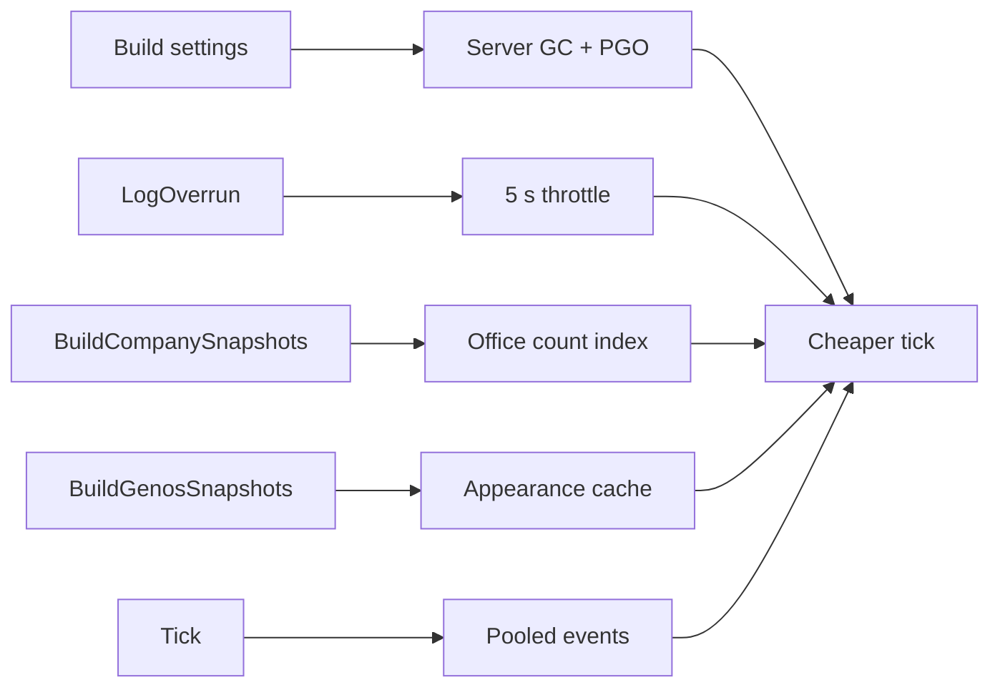

# Runtime and Hot-Path Trims — Summary

**Folder:** `01-runtime-and-hot-path-trims/`
**Status:** Implemented — see [`../IMPLEMENTATION.md`](../IMPLEMENTATION.md) for measurements and opt-in decisions.
**Tier:** 1 — cheap, high leverage

**Depends on:** V5 release state, `Genelife.API.csproj`, `SimulationLoop`, `SimulationEngine`, `PerformanceThresholds`
**Feeds:** features 02 and 03, which build on a cheaper baseline

## Objective

Cut per-tick cost without changing behavior. Enable the runtime settings the API should already have, stop logging work that makes overruns worse, and remove the two clear hot-path inefficiencies: the O(companies × offices) company snapshot and the per-genos appearance derivation on every tick.

This feature is the first pass. It should be shippable in one change set with no tick-ordering changes.

## Baseline

- `Genelife.API.csproj` has no GC, PGO or globalization settings. The API runs with workstation GC defaults.
- `SimulationLoop.LogOverrun` calls `engine.GetMetricsSnapshot()` on every overrun tick (`Genelife.Application/Services/SimulationLoop.cs:102-116`). During a sustained overrun this takes the metrics lock, sorts systems and builds strings every tick.
- `BuildCompanySnapshots` runs an `Office` query inside the per-company loop (`Genelife.Application/Services/SimulationEngine.cs:5897-5905`), so its cost is O(companies × offices).
- `BuildGenosSnapshots` calls `AppearanceMapper.TryDerive` for every genos every tick (`Genelife.Application/Services/SimulationEngine.cs:5854`).
- `Tick` allocates `List<object> events = new()` every tick and builds `TickCompleted` even when no consumer exists (`Genelife.Application/Services/SimulationEngine.cs:520`).

## Deliverables

1. Server GC, concurrent GC, tiered PGO, invariant globalization and ReadyToRun in the build.
2. Overrun logging throttled to the same 5 s cadence as dropped-tick logging.
3. Company snapshots built in one office pass, not one query per company.
4. Appearance derivation cached and invalidated only on trait, age-band or appearance-version change.
5. Per-tick event list pooled and event construction skipped when there is no consumer.

## Architecture

No tick ordering changes. The only structural change is the office index, which is a lookup table built once per snapshot.

## Tech steps

| # | Step | Phase |
|---|---|---|
| 01 | [Runtime and GC tuning](tech/01-runtime-and-gc-tuning.md) | Build |
| 02 | [Overrun logging throttle](tech/02-overrun-logging-throttle.md) | Observability |
| 03 | [Company snapshot index](tech/03-company-snapshot-index.md) | Hot path |
| 04 | [Appearance cache](tech/04-appearance-cache.md) | Hot path |
| 05 | [Tick allocation trims](tech/05-tick-allocation-trims.md) | Hot path |

## Business reading

- [Why a cheaper tick matters](business/01-why-a-cheaper-tick-matters.md)

## Definition of done

- `dotnet build GeneLife.sln` is green with the new build settings.
- The 1k and 5k `LoadHarness` runs show lower allocation per tick and no p95 regression.
- Overrun bursts no longer produce one metrics snapshot per tick.
- `BuildCompanySnapshots` cost scales with companies plus offices, not their product.
- Appearance derivation runs only for genoses whose appearance inputs changed.
- Replay and determinism tests pass unchanged.
