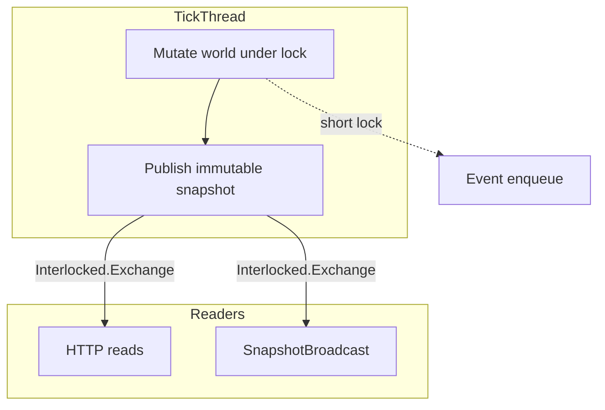

# Lock and Cadence Structure — Summary

**Folder:** `02-lock-and-cadence-structure/`
**Status:** Implemented — see [`../IMPLEMENTATION.md`](../IMPLEMENTATION.md) for measurements and opt-in decisions.
**Tier:** 2 — structural

**Depends on:** feature 01, `SimulationEngine.Tick`, `SystemRegistry`, `ISimulationSystem.Cadence`, `Metrics`, `PathfindingSystem`
**Feeds:** feature 03, which moves the remaining work off the tick thread

## Objective

Reduce how long the tick thread holds the global world lock, and stop the monthly systems from all firing on the same tick. These are the two structural causes of periodic overruns and dropped ticks.

## Baseline

- `SimulationEngine.Tick` holds one global `lock (@lock)` for the entire tick (`Genelife.API/Services/SimulationEngine.cs:526`). The same lock is taken by `World`, `Economy`, `MapVersion`, `CurrentTick`, `GetPlayerGenosNetworkId`, `BuildMapStatus` and `ExecuteWithWorld`. Any HTTP or broadcast call that touches the world blocks the tick thread and vice versa.
- `Cadence.ShouldRun` is `tick % Interval == 0` (`Genelife/Systems/ISimulationSystem.cs:20`). Every monthly system fires on the same tick, as do pay-cycle systems. That is a periodic thundering herd.
- `DecisionSystem`, `NeedsDecaySystem`, `ActionSystem`, `MovementSystem`, `PathfindingSystem`, `NeedsDeathSystem` and `VenuePresenceSystem` all run `Cadence.EveryTick` and each walks the world.
- `SystemRegistry.Update` calls `GC.GetAllocatedBytesForCurrentThread()` and `Stopwatch.GetTimestamp()` twice per system per tick, and `Metrics.RecordSystem` takes a shared lock per system per tick (`Genelife.API/Services/Metrics.cs:63-79`).
- `PathfindingSystem` runs every tick with a `budget * 256` iteration limit (`Genelife/Systems/PathfindingSystem.cs:37`).

## Deliverables

1. Expensive work moved outside the lock, with the tick publishing an immutable snapshot by exchange.
2. Read-only accessors moved to a reader/writer lock or a lock-free read path.
3. Optional per-system cadence offset so monthly and pay-cycle work is spread across the month.
4. Compatible every-tick passes merged or restructured to cut repeated query overhead.
5. System metrics sampled every N ticks with lock-free counters, and a tuned pathfinding budget.

## Architecture

The tick mutates the world under the lock, then publishes an immutable snapshot outside it. Readers take the snapshot or a read lock, never the write lock.

## Tech steps

| # | Step | Phase |
|---|---|---|
| 01 | [Lock scope reduction and double buffering](tech/01-lock-scope-reduction.md) | Concurrency |
| 02 | [Reader/writer accessors](tech/02-reader-writer-accessors.md) | Concurrency |
| 03 | [Cadence phase staggering](tech/03-cadence-phase-staggering.md) | Scheduling |
| 04 | [Merged entity passes](tech/04-merged-entity-passes.md) | Hot path |
| 05 | [Metrics sampling and pathfinding budget](tech/05-metrics-sampling-and-pathfinding-budget.md) | Observability |

## Business reading

- [Why the world lock matters](business/01-why-the-world-lock-matters.md)

## Definition of done

- The tick thread no longer holds the write lock while building snapshots or enqueueing events.
- Read-only accessors do not serialize against each other.
- Monthly systems no longer all fire on the same tick, and the periodic overrun spike is gone or reduced.
- The merged-pass change reduces full-world iterations without changing outcomes.
- Metrics overhead is bounded and pathfinding stays inside the tick budget.
- Replay and determinism tests pass unchanged.
