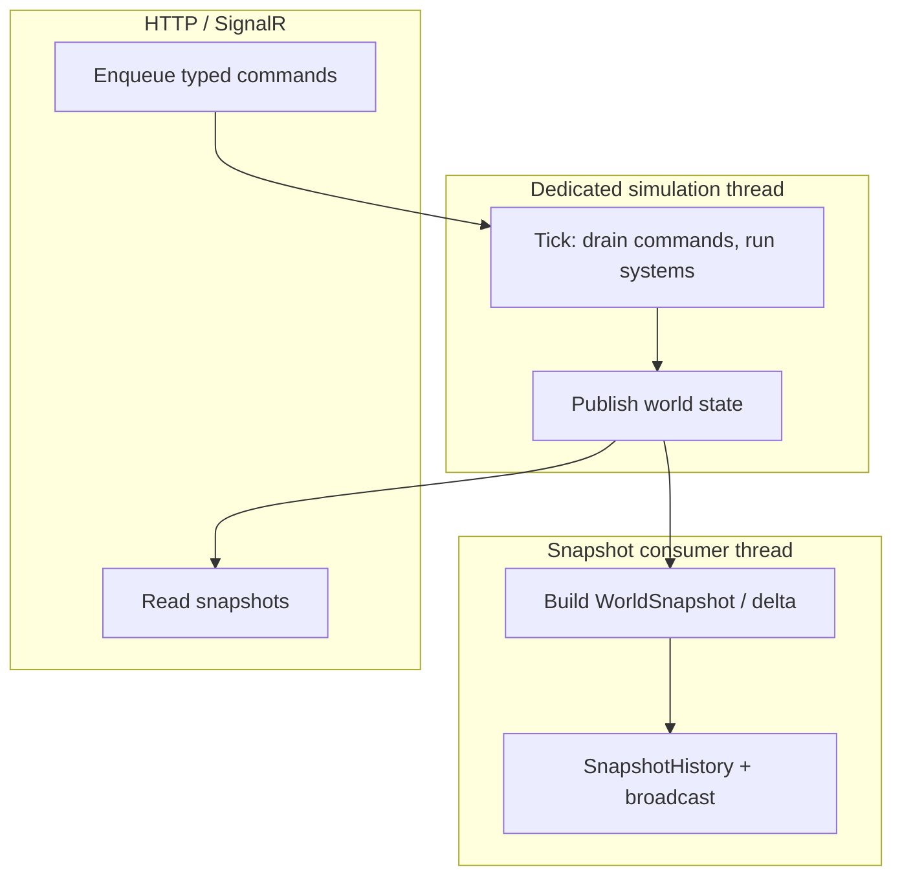

# Architecture and Parallelism — Summary

**Folder:** `03-architecture-and-parallelism/`
**Status:** Implemented — see [`../IMPLEMENTATION.md`](../IMPLEMENTATION.md) for measurements and opt-in decisions.
**Tier:** 3 — architectural

**Depends on:** features 01 and 02, `SimulationLoop` as a `BackgroundService`, `SystemRegistry`, `SnapshotBroadcastService`, `LoadHarness`
**Feeds:** long-term scale beyond 2,000 genoses

## Objective

Remove the two architectural limits that remain after tiers 1 and 2: the tick runs on a thread-pool thread shared with ASP.NET, and all world work is serial on one thread. Move the simulation to a dedicated thread, parallelize only systems that are provably independent, and build snapshots off the tick thread.

This is the highest-risk feature. It requires a determinism proof for every parallel change.

## Baseline

- `SimulationLoop` is a `BackgroundService`; each tick runs on a pool thread shared with request handling.
- `SystemRegistry.Update` runs systems serially on the tick thread.
- `SimulationEngine.Tick` builds `BuildGenosSnapshots` and `BuildCompanySnapshots` inside the tick, so snapshot construction counts against the tick budget.
- The command queue exists but request threads still take the world lock for some paths.

## Deliverables

1. A dedicated long-running simulation thread that request load cannot delay.
2. All world mutations routed through the command queue, not the request-thread lock.
3. Independent systems parallelized across Arch chunks with a fixed reduction order.
4. Snapshot and delta construction moved to a dedicated consumer thread, off the tick budget.

## Architecture

The tick thread only mutates and publishes. Snapshot construction and broadcast run on their own thread and read the published state.

## Tech steps

| # | Step | Phase |
|---|---|---|
| 01 | [Dedicated simulation thread](tech/01-dedicated-simulation-thread.md) | Concurrency |
| 02 | [Parallel independent systems](tech/02-parallel-independent-systems.md) | Parallelism |
| 03 | [Async snapshot build](tech/03-async-snapshot-build.md) | Architecture |

## Business reading

- [Why the architecture caps scale](business/01-why-the-architecture-caps-scale.md)

## Definition of done

- The tick runs on a dedicated thread and request load does not delay the timer callback.
- No request thread mutates the world outside the command queue.
- Parallel systems produce identical results to the serial path on the replay suite.
- Snapshot construction no longer counts against the tick budget.
- The 2,000-genos decade and 32-player soak stay inside the tick budget with no dropped ticks.
- Determinism and replay suites pass for NPC-only and 32-player worlds.
