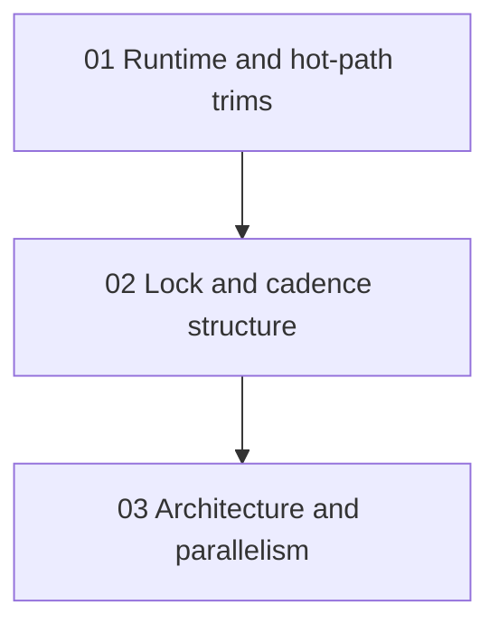

# Roadmap V6 — Tick Performance

**Scope:** server simulation loop only. No gameplay, client, economy or persistence changes.

**Target:** remove dropped ticks as a routine event by cutting per-tick cost and lock contention, so the 20 Hz loop stays inside its 50 ms budget at 2,000 sims and under 32-player API load.

**Builds on:** V5 release state, the hybrid ECS + Wolverine path, `SimulationLoop`, `FixedStepScheduler`, `SystemRegistry`, `Metrics`, `SnapshotBroadcastService`, `LoadHarness` and the existing per-NPC-tier budgets in `PerformanceThresholds`.

## What "dropped ticks" means here

`FixedStepScheduler.Advance` accumulates elapsed frame time and returns at most `MaxCatchUpTicks = 5` steps. Any backlog left over is discarded and counted as dropped ticks (`Genelife.API/Services/FixedStepScheduler.cs:32-57`, `Genelife.API/Services/SimulationLoop.cs:81-98`). A dropped tick is lost simulated time: the loop cannot keep a real-time 20 Hz cadence.

Dropped ticks are a symptom. There are two causes:

1. **Tick cost exceeds the budget.** The work inside `SimulationEngine.Tick` takes longer than 50 ms (`FixedDeltaTime = 1/20 s`).
2. **The tick thread is starved.** The loop runs on a thread-pool thread shared with ASP.NET, and `Tick` holds one global `lock (@lock)` for its whole duration (`Genelife.API/Services/SimulationEngine.cs:526`). Request and broadcast threads contend for that lock.

The three features below attack those causes in order of risk.

## Feature folders

| Folder | Feature | Tier | Tech steps |
|---|---|---|---|
| [`01-runtime-and-hot-path-trims/`](01-runtime-and-hot-path-trims/summary.md) | Runtime/GC settings, throttled overrun logging, indexed company snapshots, appearance cache, per-tick allocation trims | 1 — cheap, high leverage | 5 |
| [`02-lock-and-cadence-structure/`](02-lock-and-cadence-structure/summary.md) | Shrink the global lock, reader/writer accessors, cadence phase staggering, merged entity passes, metrics sampling and pathfinding budget | 2 — structural | 5 |
| [`03-architecture-and-parallelism/`](03-architecture-and-parallelism/summary.md) | Dedicated simulation thread, parallel independent systems, snapshot build off the tick thread | 3 — architectural | 3 |

Every feature folder contains:

- `summary.md` — objective, baseline, deliverables, architecture, steps and definition of done.
- `business/` — the feature explained in product-facing terms.
- `tech/` — ordered implementation steps with context, design, tasks, files, contracts and acceptance.

## Delivery order

1. **Runtime and hot-path trims.** Change build settings and remove obvious per-tick waste. Low risk, no behavior change, measurable immediately.
2. **Lock and cadence structure.** Reduce how long the world lock is held and stop the monthly thundering herd. Medium risk; touches tick ordering and snapshot publication.
3. **Architecture and parallelism.** Move the sim off the thread pool and parallelize safe work. Highest risk; requires determinism proof.

Features are ordered, not strictly serial. Tier 1 can land in one change set. Tier 2 and Tier 3 should each be gated by a `LoadHarness` before/after run.

## Measurement protocol

Every feature is accepted against the same harness and the same metrics. Run the 1k and 5k fixtures before and after each change (`Genelife.Performance.Tests/Performance/LoadHarness.cs`).

Record per run:

- `P50TickMs`, `P95TickMs`, `P99TickMs` — target p95 and p99 under 50 ms.
- `AllocatedBytesPerTick` — compare against the per-tier budgets in `PerformanceThresholds`.
- `Gen2CollectionsPerMinute` — server GC should reduce pause count.
- `droppedTicks` and `overruns` from `SimulationEndpoints` under load.
- The slowest systems from the overrun log.

A change is kept only if it moves at least one of p95, p99, allocation or dropped ticks without breaking determinism or the V5 acceptance runs.

## Non-goals

- No gameplay, economy, housing, family or social changes.
- No client or protocol changes.
- No second simulation path. The hybrid ECS + Wolverine path stays the only path.
- No speculative parallelism that breaks replay determinism.
- No change to the 20 Hz target rate or the 1,200 ticks/year clock.

## Definition of done for V6

- The 2,000-sim decade run stays inside the tick budget with p95 and p99 under 50 ms.
- The 32-player soak records no dropped ticks attributable to lock contention or thread-pool starvation.
- Runtime settings are in the build files and documented.
- Every retained change has a before/after `LoadHarness` record.
- Replay and determinism suites still pass for NPC-only and 32-player worlds.
