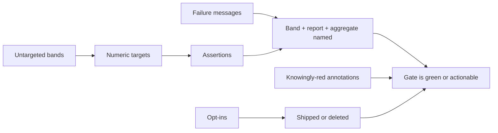

# Economic Closure and Balance Bands — Summary

**Folder:** `01-economic-closure/`
**Status:** Not started.
**Track:** 1 — the spine

**Depends on:** V5 balance bands, `BalanceScenarioTests`, `AssertBalanceBands`/`AssertTargetBands`, the `ede655b` rebalance, gabrielo's band guardrails
**Feeds:** nothing downstream; it is the gate the rest of the series is measured against

## Objective

Finish the economy's acceptance. The bands themselves are already asserted — that part is sound — so this track is not about building a gate. It is about the three gaps left around one:

1. **Three bands have no target at all**, so nothing can assert them: company failure rate, health warnings, reproduction warnings.
2. **The record around the gate rots.** The test file carried "EXPECT THIS RED" comments for a red that ended at `ede655b`, and nothing detected that it had become false.
3. **Reconciling a band failure costs a bisect**, because the failure message names neither the report file nor which aggregate it used.

Then it retires the two opt-ins, so the series does not carry "still opt-in" markers into V8.

## Baseline

- `AssertBalanceBands` asserts rent burden <= 0.40, Gini <= 0.70 and the wage share of firm revenue <= 1.00 at every scale; `AssertTargetBands` asserts unemployment, homelessness, pension funding and vacancy at the reference scale of 200; `BalanceScenarioTests` also asserts sink delta 0, conservation gap 0 and money supply growth <= 0.10 at every scale.
- Gabrielo's band guardrails recently moved from `[Skip]` to a hard assert, so the fast and performance tiers fail rather than skip.
- Rent burden and Gini are inside band as of `ede655b` (seed 21, final year): 0.2093 / 0.2917 / 0.3359 / 0.3446 and 0.50 / 0.55 / 0.57 / 0.57 at 60 / 200 / 1k / 2k, against 0.4619 / 0.4041 / 0.4619 / 0.4619 and 0.76 / 0.78 / 0.77 / 0.79 before it. `BalanceScenarioTests` is 5/5 on freshly fetched master.
- `BalanceScenarioTests` still carried comments describing rent burden and Gini as currently missing the V5 bands and telling the reader to expect the assertion red until a rebalance landed. Corrected in this branch; the general guard does not exist.
- The report holds a per-year array while `AssertBalanceBands` reads the final year (`report.Years[^1]`), and the failure message names the value without naming the file or the aggregate.
- Company failure rate is reported as 0 and never asserted; the 2k ten-year run records 61 health warnings and the 200-genos 30-year run records 4 reproduction `Warn` levels, all without targets.

## Deliverables

1. A numeric target and an assertion for each of the three untargeted bands.
2. Band failure messages that name the band, the population and seed, the observed value, the target, the report file and the aggregate used.
3. No knowingly-red assertion in the suite, and band narrative kept in step with band state.
4. `CohabitOnPairing` and cadence staggering each resolved as shipped or deleted, with the reason recorded.

## Architecture

The gate's structure does not change: bands are asserted against the target, never against the measured baseline, because a ratchet set just above the current value hides a live regression instead of reporting it.

## Tech steps

| # | Step | Phase |
|---|---|---|
| 01 | [Targets for the untargeted bands](tech/01-band-targets.md) | Targets |
| 02 | [Band failure messages](tech/02-band-failure-messages.md) | Diagnosability |
| 03 | [No expected reds](tech/03-no-expected-reds.md) | Hygiene |
| 04 | [Retire the opt-ins](tech/04-retire-opt-ins.md) | Closure |

## Business reading

- [Why a band you can check matters](business/01-why-a-band-you-can-check-matters.md)

## Definition of done

- Every band in the table in [`../STATUS.md`](../STATUS.md) has a target and an assertion, and the gate is green at 60 / 200 / 1k / 2k on the documented seeds.
- A deliberately broken band fails with a message that identifies its report file and aggregate, so the cause needs no bisect.
- No test carries an "expected red" annotation, and no comment or STATUS entry describes a band state that no longer exists.
- `CohabitOnPairing` and cadence staggering are each shipped or deleted, with the reason recorded.
- Determinism, replay, conservation and schema suites pass unchanged.
