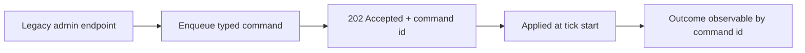

# Operator Plane Completion — Summary

**Folder:** `02-operator-plane/`
**Status:** Not started.
**Track:** 2 — secondary

**Depends on:** V6's admin command migration, `Wolverine` endpoints, the `202 Accepted` + `/api/commands/{id}` pattern already used by the newer admin endpoints
**Feeds:** safe live operation; it does not change simulation behaviour

## Objective

Finish the operator path so no admin action blocks the simulation thread. V6 recorded that the legacy admin endpoints wait up to 50 ms for the next tick; the newer endpoints already use the asynchronous `202 Accepted` + `/api/commands/{id}` pattern, so this is a migration to an existing in-repo shape rather than a new design.

## Why this matters

Live operations are the reason the admin plane exists. An endpoint that waits for the next tick couples an operator's HTTP request to the simulation loop's schedule: under load the request is slow, and the operator cannot tell "accepted and will apply" from "still waiting" or "timed out". The asynchronous pattern makes the answer immediate and the outcome observable, which is what allows live tuning to happen without risking the loop.

## Scope correction

This track was originally scoped to "pair it with V2's deferred `RelocateBuildingCommand`". **Relocation is already delivered** — `RelocateBuildingCommand` exists in `Genelife.Application/Commands/AdminCommand.cs`, is handled by the engine, and is wired as `[WolverinePost("/api/map/buildings/{networkId}/relocate")]` in `Genelife.API/Endpoints/Wolverine/MapEndpoints.cs`. V5 feature 05 records it as done, and `roadmap-v2/STATUS.md` describes it as working.

The stale line is in `ROADMAPS.md`'s V2 section, which still lists occupied-building relocation under **Deferred**. Correcting that index line is the whole of this track's relocation work; there is nothing to build.

## Baseline

- The legacy admin endpoints block up to 50 ms waiting for the next tick (V6 status, open item).
- The `202 Accepted` + `/api/commands/{id}` pattern is already implemented for the newer admin endpoints, so the target shape exists in-repo.
- `DocsConsistencyTests.Moved_routes_are_declared_on_wolverine_endpoints` and the endpoint parity tests already assert route-declaration rules for migrated endpoints.
- The exact set of still-blocking endpoints is not enumerated in V6's record; inventory is step 01.

## Deliverables

1. An inventory of the admin endpoints that still block on the tick, with the command each one maps to.
2. Those endpoints migrated to `202 Accepted` + command-id, or an explicit decision recorded for any that must stay synchronous.
3. Parity and smoke coverage for the moved routes.
4. The stale V2 "Deferred" line in `ROADMAPS.md` corrected.

## Architecture

The command path itself is unchanged: commands are still drained at tick start under the write lock. Only the HTTP response changes, from "waiting" to "accepted".

## Tech steps

| # | Step | Phase |
|---|---|---|
| 01 | [Admin endpoint migration](tech/01-admin-endpoint-migration.md) | Migration |
| 02 | [Operator parity coverage](tech/02-operator-parity-coverage.md) | Coverage |

## Definition of done

- No admin endpoint blocks waiting for the next tick; each returns `202 Accepted` with a command id, or carries a recorded reason for staying synchronous.
- Moved routes are covered by the endpoint parity tests and the admin smoke test.
- The stale V2 relocation line in `ROADMAPS.md` is corrected.
- No simulation behaviour changes: replay, determinism and balance suites are unaffected.
