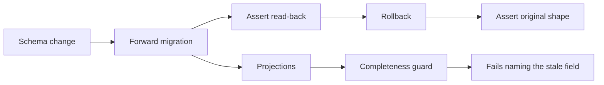

# Persistence Durability — Summary

**Folder:** `03-persistence-durability/`
**Status:** Not started.
**Track:** 3 — secondary

**Depends on:** V1->V5 schema history (4 -> 15), the V5 release checklist, `DtoGuard` and the snapshot DTO guards, the Marten read models and projections
**Feeds:** confidence in schema changes and in read models; it does not change simulation behaviour

## Objective

Make the two things that guard persistence mechanical instead of manual:

1. The schema **migration and rollback rehearsal** is a manual step in the V5 release checklist. Automate it — so it runs like any other check rather than depending on someone following
   a list.
2. **Staleness guards cover the snapshot DTOs but not the read models.** Extend the `DtoGuard` approach to projections, because the same silent-staleness defect was already found once in a DTO and found by hand.

## Why this matters

Persistence is where a mistake is least visible and most expensive. A schema change that migrates but cannot roll back is discovered at the worst possible moment, and a read-model field that quietly stops being populated produces a page that is wrong without erroring — exactly the failure the `CompaniesEqual` bug produced on the client, where seven of ten company fields never replicated and nothing complained.

Both problems are currently covered by human diligence: a checklist item and an unwritten expectation that someone notices. This track converts them into checks that fail.

## Baseline

- V1 -> V5 advanced persistence from schema 4 to 15; V6 added no schema change, which makes V7 the natural place to harden the process rather than the payload.
- The V5 release checklist still contains a manual schema 11 -> 15 migration/rollback rehearsal.
- The silent-stale-DTO defect was fixed at `ba4bb80`: `CompaniesEqual` compared three of ten `CompanyStatus` fields, so office count, balance, reserved payroll, arrears, revenue, wages and solvency never produced a delta and clients held stale values. It was found by hand, not by a test.
- `DtoGuard` now reflects over the snapshot DTOs so an omitted comparison fails naming the field, and it covers both hand-written comparisons in the repo. It does **not** cover Marten projections or read models.
- Restore coverage already includes legacy snapshots and a ten-year scenario, so the rehearsal has something to assert against.

## Deliverables

1. The schema migration/rollback rehearsal runs automatically, not as a release-checklist step.
2. Guard-style completeness checks cover the read models and projections, not only the snapshot DTOs.
3. The V5 release checklist entry is updated to reflect that the rehearsal is automated.

## Architecture

The rehearsal exercises forward and back against a real database; the guard reflects over each projection's shape the way `DtoGuard` reflects over each DTO's properties.

## Tech steps

| # | Step | Phase |
|---|---|---|
| 01 | [Migration rehearsal automation](tech/01-migration-rehearsal-automation.md) | Rehearsal |
| 02 | [Read-model staleness guards](tech/02-read-model-staleness-guards.md) | Guards |

## Definition of done

- The migration/rollback rehearsal runs as part of the standard checks rather than by hand.
- A projection or read-model field that stops being populated fails a test that names the field.
- The V5 release checklist reflects the automated rehearsal instead of restating it.
- No schema change is required by this track; it hardens the process for the next one.
